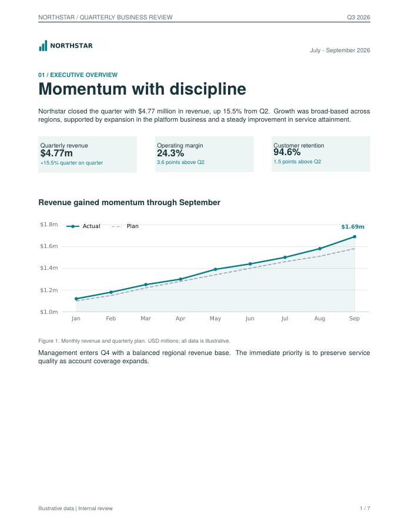
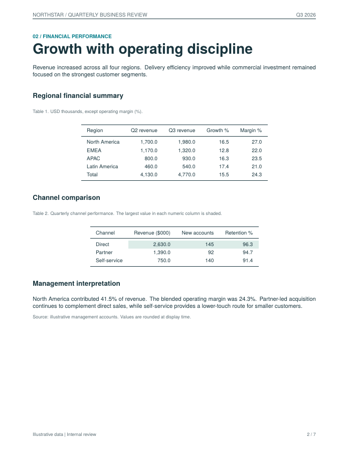
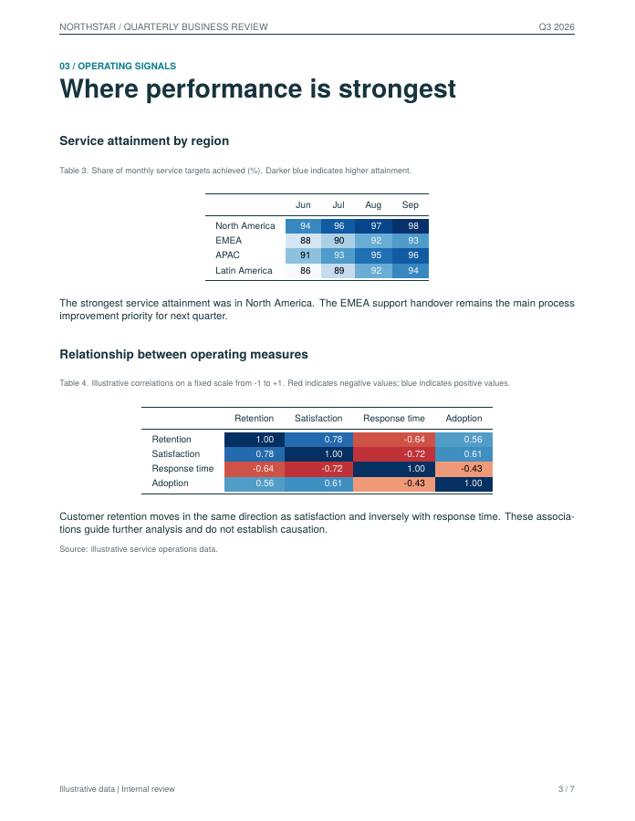
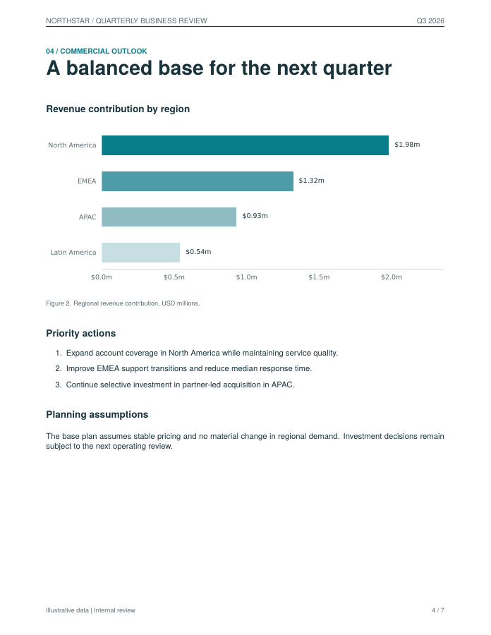
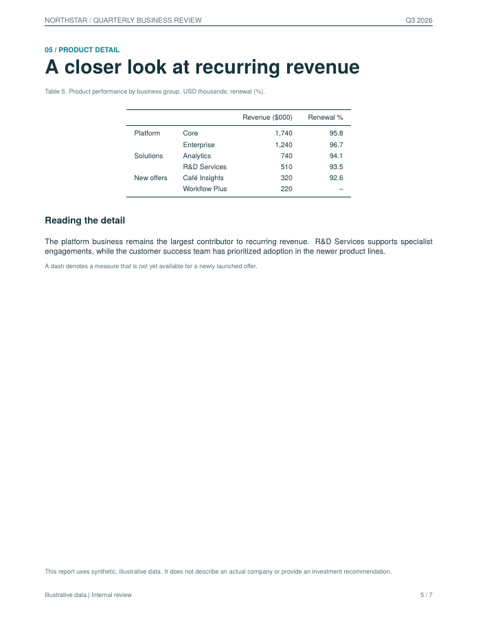
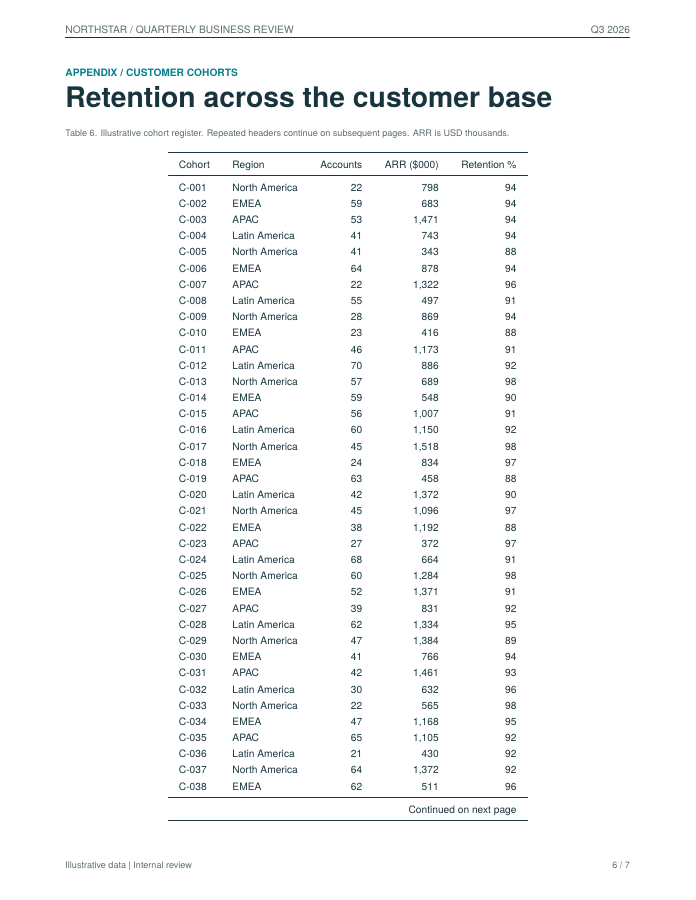
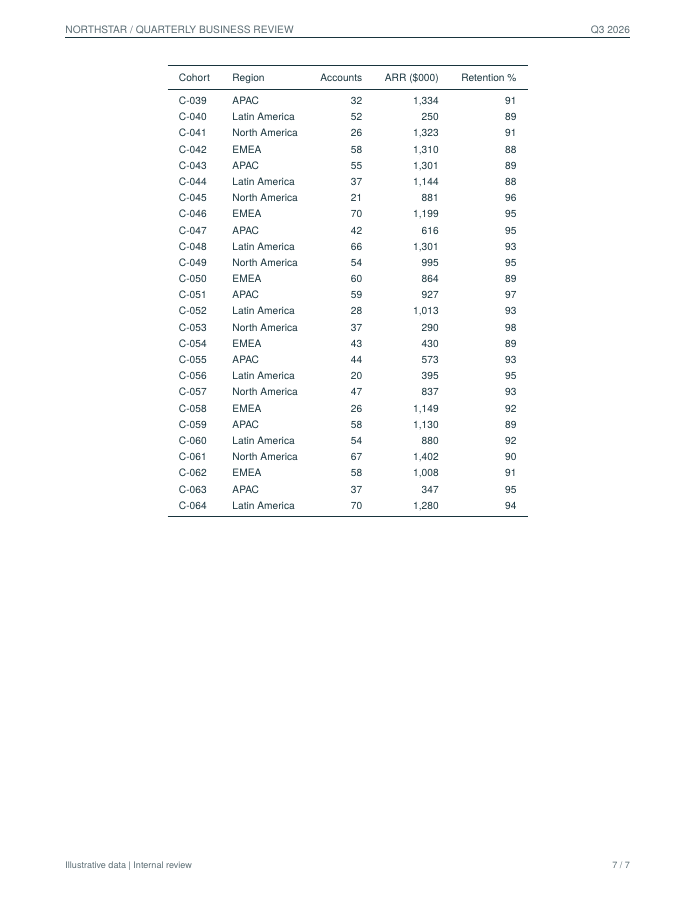
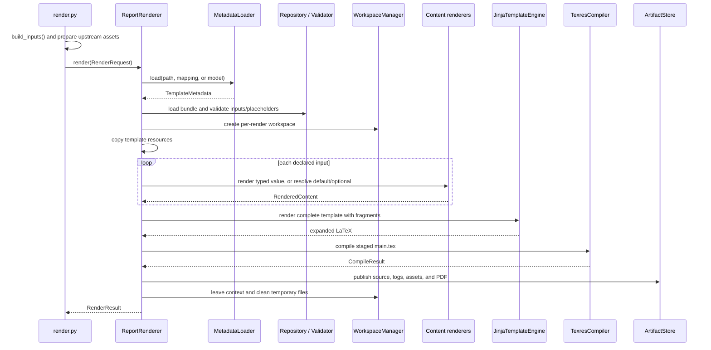

# Comprehensive example: from Python inputs to the seven-page PDF

This guide explains the Northstar sample report page by page, then follows the
objects and files through the report engine. It describes the current working
implementation. Business figures are synthetic; the sample does not call a
database or an LLM.

Start with the [generated PDF](../output/pdf/comprehensive-report.pdf), then keep
these three source files open:

| File | Responsibility |
| --- | --- |
| [main.tex](../examples/comprehensive/main.tex) | Complete document layout, headings, static paragraphs, captions, colors, fonts, page breaks, and dynamic placeholders |
| [template.json](../examples/comprehensive/template.json) or [template.yaml](../examples/comprehensive/template.yaml) | Reusable input declarations, text constraints, graphics widths, table options, defaults, and compiler engine |
| [render.py](../examples/comprehensive/render.py) | Synthetic data, derived business values, logo/chart creation, typed runtime inputs, and invocation of the public API |

The two metadata files are equivalent. `render.py` explicitly selects JSON; it
can select YAML without changing the template or input objects. There is no
mandatory runtime content file: Python passes strings, files, figures, and
DataFrames directly.

## Navigation

- [Run the example](#run-the-example)
- [Page-to-source map](#page-to-source-map)
- [Page 1: executive overview](#page-1-executive-overview)
- [Page 2: financial performance](#page-2-financial-performance)
- [Page 3: operating signals](#page-3-operating-signals)
- [Page 4: commercial outlook](#page-4-commercial-outlook)
- [Page 5: product detail](#page-5-product-detail)
- [Pages 6-7: customer cohort appendix](#pages-6-7-customer-cohort-appendix)
- [How the engine executes one render](#how-the-engine-executes-one-render)
- [Metadata and input reference](#metadata-and-input-reference)
- [Inspect or rebuild the generated artifacts](#inspect-or-rebuild-the-generated-artifacts)
- [How to modify this example](#how-to-modify-this-example)
- [Verification and current boundaries](#verification-and-current-boundaries)

## Run the example

From the repository root:

```sh
uv sync --locked
uv run python examples/comprehensive/render.py
```

texres must be on `PATH`. This example was checked with texres 0.7.10 and
XeLaTeX. The template uses `fontspec` and TeX Gyre Heros.

The main outputs are:

```text
output/
├── sample-assets/comprehensive/
│   ├── northstar.png                # Created by caller code before rendering
│   └── regional-revenue.pdf         # Created by caller code before rendering
└── pdf/
    ├── comprehensive-report.pdf     # Finished report
    └── comprehensive-report.artifacts/
        ├── main.tex                # Fully expanded document
        ├── compile.log
        └── report-assets/
            ├── <content-hash>.png   # Staged logo
            └── <content-hash>.pdf   # Two staged graphs, each in its own file
```

Generated files under `output/` are ignored by Git. Run the example to regenerate
the PDF and artifacts after cloning. The page images embedded below are retained
documentation snapshots of the seven-page sample.

## Page-to-source map

The template starts six document sections. Its five explicit `\newpage` commands
start pages 2-6. The cohort `longtable` naturally continues onto page 7; there is
no separate template section or manual page break for that continuation.

| PDF page | Visible section | Dynamic placeholders | Main conversion |
| --- | --- | --- | --- |
| 1 | 01 / Executive overview | `logo`, `period`, `title`, `summary`, `revenue`, `growth`, `margin`, `retention`, `trend`, `outlook` | Text escaping, PNG staging, live figure export |
| 2 | 02 / Financial performance | `financial`, `comparison`, `financial_commentary` | Native tables, maximum highlighting, escaped commentary |
| 3 | 03 / Operating signals | `sequential`, `diverging` | Native tables with cell background/text colors |
| 4 | 04 / Commercial outlook | `regional_graph`, `assumptions`, `optional_note` | Existing graph PDF staging, default text, omitted optional input |
| 5 | 05 / Product detail | `products`, `disclaimer` | MultiIndex table, missing-value formatting, escaped disclaimer |
| 6-7 | Appendix / Customer cohorts | `cohorts` | Paginated native `longtable` with repeating headers |

All pages share the template's `fancyhdr` header/footer definitions. Page numbers
come from `\thepage`; the total comes from `\pageref{LastPage}` and compiler reruns.
These are LaTeX features, not runtime input values.

## Page 1: executive overview



| Visible element | Template location | Runtime source / behavior |
| --- | --- | --- |
| Northstar logo, upper left | `<<logo>>` | `make_logo()` creates `northstar.png`; `ImageInput(logo)` sends it to `ImageRenderer` |
| Reporting period, upper right | `<<period>>` | `TextInput("July - September 2026")` |
| Section eyebrow | `\pagetitle{01 / EXECUTIVE OVERVIEW}{...}` | Literal template text |
| “Momentum with discipline” | Second argument of `\pagetitle`, `<<title>>` | A `TextInput` constrained to 100 characters |
| Executive summary | `<<summary>>` | Python formats computed Q3 revenue and growth into a string; maximum 1,500 characters |
| Revenue card | `\kpi{Quarterly revenue}{<<revenue>>}{<<growth>>}` | Python supplies formatted revenue and growth strings |
| Margin card | `\kpi{Operating margin}{<<margin>>}{3.6 points above Q2}` | Margin value is computed; supporting comparison text is literal template content |
| Retention card | `\kpi{Customer retention}{<<retention>>}{1.5 points above Q2}` | `94.6%` is an illustrative supplied string; supporting comparison is literal template content |
| Revenue line chart | `\begin{center}<<trend>>\end{center}` | `FigureInput(trend)` contains a live matplotlib figure |
| Figure title/caption | `\subsection*{...}` and `\note{Figure 1...}` | Literal template text |
| Closing outlook paragraph | `<<outlook>>` | Supplied `TextInput` |

### Where the headline values come from

`build_inputs()` creates monthly revenue and plan arrays. It computes these
business values before calling the report engine:

```text
Q2 revenue = April + May + June = 1.30 + 1.39 + 1.44 = $4.13m
Q3 revenue = July + August + September = 1.50 + 1.58 + 1.69 = $4.77m
Growth = (4.77 / 4.13 - 1) × 100 = 15.5% after display rounding
Margin = revenue-weighted average of regional margins = 24.3% after rounding
```

The renderer receives the finished strings. It does not calculate revenue,
reconcile the cards against tables, or decide what the summary should say.

The `\kpi` macro defines shaded boxes, typography, and spacing. For example, the
input `TextInput("$4.77m")` becomes `\$4.77m`, which is inserted into that macro's
value argument. The escaping preserves the dollar sign as visible text.

### How the live chart reaches the page

1. Python creates a `Figure` with actual/plan lines, markers, labels, legend, and
   light area shading. `style_axis()` supplies the chart styling.
2. The input mapping contains `"trend": FigureInput(trend)`.
3. Metadata declares `trend` as `type: graph` with width `1\linewidth`.
4. `RendererRegistry` selects `GraphRenderer` for that declaration.
5. `GraphRenderer` calls `MatplotlibFigureExporter.export()`.
6. The exporter writes the figure to PDF and restores its dimensions and axes
   layout afterward, including on export failure. Drawing can populate internal
   Matplotlib caches. Figures that request matplotlib `usetex` are rejected.
7. The asset helpers validate and stage that PDF under a content-derived name.
8. The prepared fragment is inserted into `<<trend>>`:

```tex
\includegraphics[width=1\linewidth]{report-assets/<content-hash>.pdf}
```

The generated filename varies with the PDF bytes. The actual fragment has the
hash, not the illustrative `<content-hash>` text above. XeLaTeX includes the vector
graph in the complete document; matplotlib never lays out the report page.

## Page 2: financial performance



### Table 1: regional financial summary

`build_inputs()` creates the `financial` DataFrame with four regional rows and
one computed total row. The columns are region, Q2 revenue, Q3 revenue, growth,
and operating margin. Python computes growth percentages and the total row.

The three pieces connect as follows:

```python
inputs["financial"] = TableInput(financial)
```

```json
{
  "type": "table",
  "preset": "financial",
  "precision": 1,
  "show_index": false
}
```

```tex
\note{Table 1. USD thousands, except operating margin (\%).}
\begin{center}\small <<financial>>\end{center}
```

`StylerTableRenderer` copies the DataFrame, escapes its strings/labels, formats
floating values with one decimal and thousands separators, hides the generated
row index, and emits a `tabular` environment with booktabs rules. A shortened
portion of the expanded source looks like this:

```tex
\begin{tabular}{lrrrr}
\toprule
Region & Q2 revenue & Q3 revenue & Growth \% & Margin \% \\
\midrule
North America & 1,700.0 & 1,980.0 & 16.5 & 27.0 \\
% Remaining regional rows and the total row follow here.
\bottomrule
\end{tabular}
```

The `financial` preset currently means this standard formatted table. It does
not infer currencies, insert totals, bold a total row, or calculate margins.
Those values and units come from the caller and the surrounding template.

### Table 2: channel comparison

The `comparison` DataFrame holds Direct, Partner, and Self-service performance.
Metadata chooses `preset: comparison`, `precision: 1`, and `show_index: false`.

The table renderer calls `highlight_max(..., axis=0)` on numeric columns. Direct
has the largest revenue, account count, and retention in the supplied sample,
so three cells in that row receive a pale green background. If the values change,
the highlighted cells change with them. The rule selects the largest value; it
does not understand whether a metric is better when smaller.

The highlights become native `\cellcolor[HTML]{DCECE8}` commands through Styler's
CSS-to-LaTeX conversion. The template loads `xcolor` with the `table` option.

### Commentary and captions

`<<financial_commentary>>` is escaped text. Its 41.5% contribution and 24.3%
margin are formatted by Python. The heading, introductory paragraph, table
numbers, captions, and source note are static `.tex` content. Captions in this
example use the custom `\note` macro and literal numbering; they are not generated
by the table adapter or an automatic caption registry.

## Page 3: operating signals



Both heatmaps are actual LaTeX tables, including their numbers and row/column
labels. They are not chart screenshots.

| Table | Python data | Metadata | Renderer behavior |
| --- | --- | --- | --- |
| Table 3: service attainment | `sequential`: 4 regions × 4 months | `preset: heatmap_sequential`, `precision: 0` | Styler `background_gradient(axis=None, cmap="Blues")`; a single scale spans all numeric cells |
| Table 4: operating correlations | `diverging`: a supplied 4 × 4 matrix | `preset: heatmap_diverging`, `precision: 2` | Styler `background_gradient(axis=None, cmap="RdBu", vmin=-1, vmax=1)` |

For the sequential table, 86 is the light end and 98 the dark end in this sample.
The scale is based on this table's data; it is not fixed to 0-100. For the
diverging table, the scale stays fixed to -1 through +1, with zero at its center.
Negative correlations are red and positive ones blue.

Styler supplies cell backgrounds and contrasting text colors. `to_latex` converts
them into `\cellcolor` and `\color` commands. The template supplies table placement,
captions, explanatory paragraphs, and the source note.

Heatmap inputs must have numeric columns and at least one finite value. The
correlation matrix in the example is supplied directly; neither Python's example
code nor the report engine computes it from raw observations.

## Page 4: commercial outlook



### Existing graph file

Python creates a horizontal regional bar chart and saves it as
`regional-revenue.pdf` inside `build_inputs()`, before the render call:

```python
inputs["regional_graph"] = GraphInput(graph_file)
```

This uses the same metadata type, `graph`, as the live figure on page 1. The
runtime wrapper chooses the path through `GraphRenderer`:

| Runtime wrapper | What GraphRenderer does |
| --- | --- |
| `FigureInput(figure)` | Export the figure, restore its dimensions/axes layout, then stage the PDF |
| `GraphInput(path)` | Validate and stage the supplied file directly |

For `regional_graph`, the engine does not replot the bars. It validates the PDF
signature, hashes/copies the asset, and inserts a graphics command at
`<<regional_graph>>`. Its caption remains template text.

### Default and optional text

`build_inputs()` deliberately supplies neither `assumptions` nor `optional_note`.

| Placeholder | Metadata | Result |
| --- | --- | --- |
| `<<assumptions>>` | `type: text` with a default sentence | The service creates a `TextInput` from the default, then escapes and renders it |
| `<<optional_note>>` | `type: text`, `required: false`, no default | The service binds an empty `RenderedContent`; no text appears |

An input with a default may be omitted even though `required` otherwise defaults
to true. An empty supplied `TextInput("")` is still a supplied value; it is not
replaced with the default.

The three priority actions are a native `enumerate` list written in the template.
They are not Markdown and do not demonstrate a separate list-input adapter.

## Page 5: product detail



`products` has a two-level pandas MultiIndex: business group, then product.
Its six rows sum to the same $4.77m quarterly revenue used in the summary.

```python
inputs["products"] = TableInput(products)
```

Metadata selects `financial` formatting with precision 1. It leaves the index
visible, so the two index levels become the left-hand table columns. The native
table output uses `\multirow` for repeated business-group labels such as Platform.
The template loads the `multirow` package.

This table also illustrates:

- **Escaped labels:** the product string `R&D Services` becomes `R\&D Services`
  in generated TeX and appears as normal business text in the PDF.
- **Accented characters:** `Café Insights` is preserved; XeLaTeX and the template
  font handle the character.
- **Missing values:** the final renewal rate is `NaN`; the table formatter emits
  `--`, which LaTeX displays as a dash.
- **Numeric dtype behavior:** the revenue column contains integers, which remain
  integer displays. Precision 1 applies to the floating renewal rates.

The explanatory paragraph and missing-value note are static template text.
`<<disclaimer>>` is a supplied `TextInput`. `\vfill` in the template positions
that disclaimer near the bottom of the page; the text renderer does not choose
its placement.

## Pages 6-7: customer cohort appendix





`build_inputs()` creates 64 cohort rows using a seeded random generator
(`default_rng(42)`). This makes the illustrative register repeatable. It contains
cohort ID, region, accounts, annual recurring revenue, and retention.

The input is an ordinary `TableInput(cohorts)`. Pagination is selected by metadata:

```json
{
  "type": "table",
  "precision": 0,
  "show_index": false,
  "longtable": true
}
```

There is no special caller-side pagination object. `StylerTableRenderer` passes
`environment="longtable"` to Styler, which emits:

| Generated command | Visible result |
| --- | --- |
| `\begin{longtable}` | Table can span pages without a floating `table` wrapper |
| `\endfirsthead` | Ends the first-page header definition |
| `\endhead` | Ends the header repeated on continuation pages |
| `\endfoot` | Ends the continuation footer, including “Continued on next page” |
| `\endlastfoot` | Ends the final footer definition |

In the checked PDF, C-001 through C-038 appear on page 6 and C-039 through C-064
on page 7. XeLaTeX decides where the break fits. Different fonts, spacing, row
counts, or template margins can change the break and total page count.

The appendix title/caption appears once, before `<<cohorts>>`. The repeated header
on page 7 belongs to the generated table. Shared page headers/footers still come
from the template's page style.

## How the engine executes one render

### Entry point and object composition

`main()` in the example configures plotting defaults, builds the inputs, and calls:

```python
result = create_renderer().render(
    RenderRequest(
        template=BUNDLE,
        metadata=BUNDLE / "template.json",
        inputs=inputs,
        output=ROOT / "output/pdf/comprehensive-report.pdf",
    )
)
```

`RenderRequest` describes this invocation. `TemplateMetadata` describes reusable
template inputs and presentation defaults. They are separate objects.

The [composition root](../src/report_agent/application/bootstrap.py) wires the
following concrete collaborators into `ReportRenderer`:

| Responsibility | Object / source |
| --- | --- |
| Orchestration | [ReportRenderer](../src/report_agent/application/service.py) |
| Parse and validate metadata | [MetadataLoader](../src/report_agent/metadata/loader.py), [metadata models](../src/report_agent/metadata/models.py) |
| Resolve template resources | [LocalTemplateRepository](../src/report_agent/templates/repository.py) |
| Check placeholder/input compatibility | [RenderValidator](../src/report_agent/application/validation.py) |
| Choose content strategy | [RendererRegistry](../src/report_agent/rendering/registry.py) |
| Plain text | [TextRenderer](../src/report_agent/rendering/text.py), [escape_text](../src/report_agent/rendering/latex.py) |
| Image files | [ImageRenderer](../src/report_agent/rendering/images.py), [asset helpers](../src/report_agent/rendering/assets.py) |
| Graphs and figures | [GraphRenderer](../src/report_agent/rendering/graphs/renderer.py), [MatplotlibFigureExporter](../src/report_agent/rendering/graphs/adapters.py) |
| Native tables | [StylerTableRenderer](../src/report_agent/rendering/tables.py) |
| Complete template expansion | [JinjaTemplateEngine](../src/report_agent/templates/engine.py) |
| PDF compilation | [TexresCompiler](../src/report_agent/compilation/texres.py) |
| Temporary build lifetime | [TemporaryWorkspaceManager](../src/report_agent/storage/workspace.py) |
| Retain finished artifacts | [LocalArtifactStore](../src/report_agent/storage/artifacts.py) |

Replaceable boundaries use `Protocol` contracts. Implementations are composed
through the service constructor; the facade does not hard-code rendering details.



### Stage 1: metadata, template, and input validation

`MetadataLoader` chooses a parser by file extension (`.json`, `.yaml`, `.yml`).
A mapping goes directly to the same Pydantic schema; an existing metadata model
is accepted directly. The current loader takes `Path` objects for file sources.

`LocalTemplateRepository` verifies the `.tex` entrypoint and collects non-hidden
bundle files. It rejects symlink resources and parent-traversing entrypoints.
`RenderValidator` inspects template variables, including statically named Jinja
partials, and checks:

- Every referenced input is declared in metadata.
- Every visible declared input has a template placeholder; hidden context inputs
  have none.
- Runtime input names are declared.
- Required values are present, unless a default is available.
- Runtime wrappers match the declared types.
- Supplied text respects character limits.
- The selected type/backend has a registered renderer.

Output paths must end in `.pdf`. Graphics dimensions and table option compatibility
are checked by metadata validation. Asset content and table data are checked
later by their content adapters, before compilation.

### Stage 2: workspace and content preparation

The workspace manager creates a unique temporary directory. The service copies
bundle resources into its `template/` subdirectory and operates on the copy.
The original `.tex` source is preserved.

For each declared input, the service resolves a supplied value, text default,
or empty optional value. The registry maps metadata type and backend to strategy:

```text
text  -> TextRenderer
image -> ImageRenderer
graph -> GraphRenderer
table, styler -> StylerTableRenderer (default table backend)
```

Each strategy returns `RenderedContent`: a trusted LaTeX fragment, any generated
asset paths, and required package names. After Jinja expansion, the service checks
those requirements against literal template declarations, local TeX/style/class
dependencies, and explicit `provided_packages` assertions. Missing declarations
produce `missing_package` diagnostics naming the input before compilation. The
complete template must load its packages; the service does not edit the preamble.
The scanner is not a full TeX interpreter or an installed-package checker.

Text escapes special characters exactly once. Blank lines preserve paragraph
boundaries; single newlines behave as spaces in normal LaTeX text. Markdown is
not interpreted. Native table strings and labels are escaped through Styler.

Graphics accept PNG, JPEG, and PDF. Raster assets are verified with Pillow; PDF
assets are checked for a PDF signature. Files are copied into `report-assets/`
using the first 24 hexadecimal characters of their SHA-256 content hash. Graphics
commands reference those controlled relative filenames instead of caller paths.

### Stage 3: complete document expansion

Jinja uses `<<...>>` variables, `<%...%>` blocks, and `<#...#>` comments to avoid
conflicts with ordinary LaTeX braces. It runs with `StrictUndefined` after
optional/default handling.

The engine inserts the prepared fragments into the whole template once. It does
not evaluate inserted user strings as another Jinja template. The result is a
normal `.tex` document containing escaped text, `\includegraphics`, `tabular`, and
`longtable` content. Table fragments also receive source comments so compiler
overflow line ranges can identify the input. After package validation, the expanded
document is written in the workspace.

### Stage 4: compilation

`TexresCompiler` maps the metadata's `xelatex` engine to the `-xelatex` flag.
Its effective invocation is equivalent to:

```sh
texres -xelatex \
  --cache-directory <private-build-directory>/cache \
  -output-directory <private-build-directory> \
  --keep-logs -halt-on-error \
  -latexoption=-no-shell-escape main.tex
```

The wrapper runs in the staged entrypoint directory, captures the process output,
and defaults to a 120-second timeout. Each build receives private compiler output
and cache directories. texres handles the engine passes needed by the document,
including references such as the total page count.

The wrapper checks the exit status, output file, and PDF signature. It normalizes
compiler failures, missing output, timeouts, and selected warnings into
`Diagnostic` objects. It does not perform visual layout inspection itself.

### Stage 5: publication and cleanup

The service retains expanded source, available compiler logs, prepared graphics,
and supported local template resources. It publishes the final PDF only when
there are no compiler errors and a PDF exists. Individual artifact publication
uses a temporary destination file followed by replacement.

The workspace context then cleans temporary files. `RenderResult` contains
`pdf_path`, diagnostics, and retained artifact paths. Compilation failures retain
source/logs/assets when available and leave any previous destination PDF intact.
Failures before source generation may have diagnostics without retained artifacts.

## Metadata and input reference

The sample declares 21 inputs. Python supplies 19; `assumptions` uses a default
and `optional_note` is empty.

| Name | Metadata type | Runtime wrapper / origin | PDF location |
| --- | --- | --- | --- |
| `logo` | image | `ImageInput`, generated PNG | Page 1, header area |
| `period` | text | `TextInput` | Page 1, upper right |
| `title` | text | `TextInput`, max 100 characters | Page 1, main title |
| `summary` | text | `TextInput`, max 1,500 characters | Page 1, opening paragraph |
| `revenue` | text | Formatted computed value | Page 1, revenue KPI |
| `growth` | text | Formatted computed value | Page 1, revenue KPI comparison |
| `margin` | text | Formatted weighted average | Page 1, margin KPI |
| `retention` | text | Supplied illustrative string | Page 1, retention KPI |
| `trend` | graph | `FigureInput`, live figure | Page 1, Figure 1 |
| `outlook` | text | `TextInput` | Page 1, closing paragraph |
| `financial` | table | `TableInput`, 5 × 5 DataFrame | Page 2, Table 1 |
| `comparison` | table | `TableInput`, 3 × 4 DataFrame | Page 2, Table 2 |
| `financial_commentary` | text | Formatted commentary string | Page 2, interpretation |
| `sequential` | table | `TableInput`, 4 × 4 DataFrame | Page 3, Table 3 |
| `diverging` | table | `TableInput`, 4 × 4 DataFrame | Page 3, Table 4 |
| `regional_graph` | graph | `GraphInput`, saved PDF | Page 4, Figure 2 |
| `assumptions` | text | Metadata default | Page 4, planning assumptions |
| `optional_note` | text | Omitted, optional | Page 4, no visible output |
| `products` | table | `TableInput`, 6 × 2 DataFrame with 2 index levels | Page 5, Table 5 |
| `disclaimer` | text | `TextInput` | Page 5, bottom note |
| `cohorts` | table | `TableInput`, 64 × 5 DataFrame | Pages 6-7, Table 6 |

Dimensions in this table count DataFrame data columns, excluding index levels.
Metadata defaults to `required: true`; the sample explicitly makes only
`optional_note` optional without a default.

## Inspect or rebuild the generated artifacts

To understand what compilation received, open the generated
[expanded source](../output/pdf/comprehensive-report.artifacts/main.tex) beside
the [original template](../examples/comprehensive/main.tex). Look for the inserted
escaped strings, graphics commands, and table environments. The expanded source
has no remaining report placeholders.

The [compiler log](../output/pdf/comprehensive-report.artifacts/compile.log) is the
place to investigate TeX failures or overfull-box warnings. Actual asset hashes
are visible in the generated `\includegraphics` commands.

The retained source and assets can be compiled without rerunning the example's
data or graph preparation. With the same compatible texres installation:

```sh
cd output/pdf/comprehensive-report.artifacts
texres -xelatex main.tex
```

This rebuild still depends on the compiler's packages and fonts. Retained artifacts
are a reproducible source bundle, not a self-contained TeX distribution or a
promise of byte-identical PDFs across environments.

## How to modify this example

| Desired change | Edit | Why |
| --- | --- | --- |
| Change revenue or channel figures | Arrays/DataFrames in `build_inputs()` | Business data and derived values are caller-owned |
| Change logo artwork | `make_logo()` or replace the supplied `ImageInput` path | Image rendering only stages the result |
| Change line/bar style | Figure-building code and `style_axis()` | Chart appearance belongs to the figure, not Jinja |
| Use an existing graph instead of a figure | Supply `GraphInput(path)` for `trend` | Metadata can remain `type: graph` |
| Make a graph narrower | Its metadata `width`, e.g. `0.85\linewidth` | The graphics adapter turns that dimension into a command option |
| Change numerical precision or hide an index | Table metadata `precision` / `show_index` | These are table presentation options |
| Change heatmap behavior | Select a supported metadata preset; extend `StylerTableRenderer` for a new policy | Presets are implemented renderer strategies, not arbitrary CSS |
| Add a runtime text section | Add a `.tex` placeholder, metadata declaration, and `TextInput` | All three must agree on the input name |
| Add/change a static paragraph | `main.tex` | No runtime value or metadata field is needed |
| Add data rows to the appendix | `cohorts` DataFrame | `longtable` manages continuation pages |
| Change fonts, margins, page headings, captions, or KPI boxes | `.tex` preamble/macros/body | The template owns page design |
| Move the disclaimer | `\vfill` and surrounding template layout | TextRenderer does not determine position |
| Switch JSON to YAML | Change the selected metadata path in `main()` | Both formats validate against one schema |

When copying the example into a real report, review both dynamic inputs and
static business prose. For example, KPI comparison notes, captions, the priority
list, and several explanatory paragraphs are literal template content; changing
the data will not automatically rewrite them.

## Verification and current boundaries

The [comprehensive integration test](../tests/integration/test_comprehensive_pdf.py)
builds the actual example and checks seven pages, selected text, repeated cohort
headers, three retained graphics assets, and successful compilation without
diagnostics. [Content adapter tests](../tests/unit/test_content_adapters.py) cover
asset validation, safe staging names, width constraints, caller figure state,
table escaping, presets, and longtable output. Other tests cover metadata,
input validation, failures, publication, and workspace cleanup.

The initial PDF was also rasterized and visually inspected on all seven pages.
The PNG snapshots in this document show that checked layout. Text extraction alone
would not detect clipping, overlapping KPI cards, or poor chart spacing.

The [benchmark guide](../benchmarks/README.md) records a historical local median of 380 ms
for rendering this report and 430 ms including caller-side preparation. Those
measurements exclude Python startup, database retrieval, and model calls and are
not a concurrency or production latency guarantee.

The current renderer does not query databases, generate prose, validate business
claims, automatically calculate totals, infer units, resize wide tables, select
landscape pages, or generate a report from a chart-definition language. These
responsibilities must be supplied by caller code, template authors, or future
explicit integrations. The example demonstrates the implemented path from
prepared content and a complete template to a PDF.
