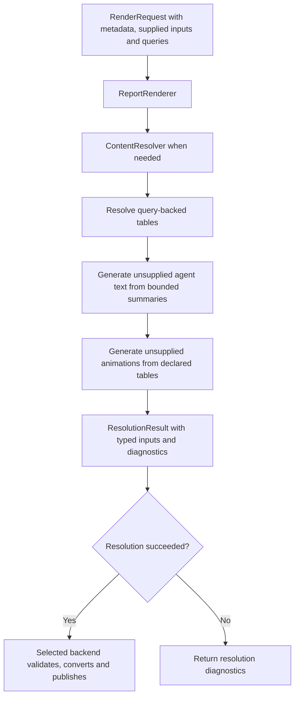

# Resolving report content

The optional `resolution` package prepares normal typed render inputs through
injected interfaces. It contains no Snowflake/Postgres driver, database credentials,
model SDK, or live SQL/LLM implementation. Inject a `ContentResolver` through
`create_renderer(resolver=...)`. Normal rendering resolves query bindings and
non-user sources before backend validation. The same path supports both metadata
schemas, PDF and Office output. Explicit values override agent/generator inputs.



## Metadata

```json
{
  "id": "sales",
  "inputs": {
    "sales": {"type": "table", "visible": false, "summary_head_rows": 5},
    "summary": {
      "type": "text",
      "source": "agent",
      "prompt": "Summarize quarterly sales",
      "uses": ["sales"],
      "max_chars": 1200
    }
  }
}
```

`source` defaults to `user`. Agent-sourced text accepts `prompt` and `uses`.
Office animation inputs also accept `source: generator` and table dependencies
in `uses`; see the [Office guide](office-reports.md#animation-generation).
An agent input requires a non-empty prompt and an explicit positive `max_chars`.
Every `uses` name must identify a
declared table. Agent-to-agent dependencies are not accepted; the supported
dependency order is prepared/query-backed tables, then agent text, then Office
animations. Each generation step skips values already supplied by the caller.

`visible` defaults to `true`. Set `visible: false` on a context-only table that
the generator needs but the report should not display. It remains a declared,
typed, required input (unless `required: false`); the resolver fetches and
summarizes it normally. It needs no template placeholder and the renderer skips
its conversion, styling, assets, and package requirements. Referencing a hidden
input in a template is a `hidden_placeholder` error. A table in `uses` must still
be resolved even if it is optional in metadata.
Hidden inputs must be referenced by an agent or animation generator's `uses`;
metadata rejects unreferenced hidden declarations as dead configuration.

The prompt may be text or an identifier understood by your generator adapter.
No prompt registry is built into the renderer. JSON/YAML metadata share the same
schema. Declaring a source does not install a model or database adapter. If an
unsupplied input needs an unconfigured adapter, rendering returns a
`resolution_failed` diagnostic with the input name, before conversion starts.

## Python interface

Illustrative application wiring; the adapters are application-owned objects:

```python
from report_agent import RenderRequest, create_renderer
from report_agent.resolution import ContentResolver, QuerySource

resolver = ContentResolver(
    sources={"postgres_reports": my_read_only_data_source},
    text_generator=my_text_generator,
    summary_max_columns=20,
    summary_max_row_chars=8192,
)
renderer = create_renderer(resolver=resolver)
result = renderer.render(
    RenderRequest(
        template_path,
        metadata,
        supplied_inputs,
        output_path,
        queries={
            "sales": QuerySource(
                connection="postgres_reports",
                query="SELECT region, revenue FROM reporting.quarterly_sales",
                row_limit=1000,
            )
        },
    )
)
if result.output_path is None:
    handle_resolution_failure(result.diagnostics)
```

`RenderRequest.queries` defaults to an empty mapping. The renderer calls the
resolver when queries are supplied or metadata declares an agent/generator source.
It keeps generated media alive through conversion and publication, then removes
the temporary resolution workspace on success, failure or cancellation.

Explicit `resolver.resolve(...)` calls remain available for applications needing
a separate preparation step. With that interface, the caller owns the media
workspace lifetime and must check `ResolutionResult.diagnostics` before rendering.

## CLI wiring

Put adapter construction in an importable application module. A no-argument
factory such as `myapp.reports:create_resolver` must return `ContentResolver`:

```python
def create_resolver():
    return ContentResolver(
        sources={"postgres_reports": my_read_only_data_source},
        text_generator=my_text_generator,
    )
```

Save query bindings in `queries.yaml`:

```yaml
queries:
  sales:
    connection: postgres_reports
    query: SELECT region, revenue FROM reporting.quarterly_sales WHERE period = :period
    params:
      period: Q3
    row_limit: 1000
```

```sh
uv run report render templates/monthly_report \
  --metadata templates/monthly_report/template.yaml \
  --inputs data/monthly-inputs.yaml \
  --resolver myapp.reports:create_resolver \
  --queries queries.yaml \
  --output output/monthly-report.docx
```

For this query-backed example, omit `sales` from the input manifest: a name cannot
have both a direct value and a query. Agent text and animation values can still be
overridden with `--text` / `--animation`. `--resolver` executes trusted application
code chosen explicitly by the CLI caller; template metadata and query files cannot
select Python modules. JSON query files use the same `queries` mapping.

`DataSource.fetch(QuerySource)` must return a non-empty DataFrame. The resolver
checks the returned row count and errors if the limit is exceeded; it never
silently truncates data. This check occurs **after fetching** and does not limit
query cost or execution time by itself.

The adapter must validate SQL and object access before execution, bind parameters,
use database-enforced read-only access, enforce execution/result limits, and apply
timeouts. This interface and a `row_limit` field alone do not make arbitrary SQL
safe. Live adapters require those implementations and tests before deployment.
Apply a server-side row bound **before fetching**: for example, construct a
validated query with `LIMIT row_limit + 1`, using the adapter's dialect-aware SQL
builder. Fetching the extra row lets the resolver detect an exceeded limit rather
than silently returning a truncated report. Do not append SQL blindly; adapter
validation, binding, read-only permissions, and timeouts still apply.

## Agent text and table summaries

`AgentTextGenerator.generate(request)` receives a `GenerationRequest` with
`prompt`, `tables`, `max_chars`, and optional `retry_feedback`. Import it from
`report_agent.resolution`. Adapters should include the character limit in their
model instructions.

`request.tables` maps only explicitly permitted table names to `TableSummary`
objects. Each summary contains
row/column counts and up to `summary_max_columns` column profiles. Column names
are capped at 120 characters. Profiles include dtype, non-null count, and finite
numeric min/max/mean where applicable. Raw rows and free-text cells are excluded
by default. SQL, credentials, and the full DataFrame are never passed.

**`summary_head_rows` sends raw cell data to the model.** It is disabled by default.
For category or time-series context, explicitly set `summary_head_rows` on the
table declaration (0 by default, at most 20). `TableSummary.head_rows` then holds
that many leading rows, limited to the summarized columns. Cells preserve simple
numeric/boolean values; missing/nonfinite values become `None`, and other values
are strings capped at 200 characters. Each row follows `TableSummary.columns`
order. This opt-in exposes cell values to the generator, including text, so select
only intended columns in the query. Indices are excluded.

`ContentResolver(summary_max_row_chars=8192)` caps the combined row samples across
all `uses` tables in one generation request, including its retry. The budget
counts compact JSON characters (Unicode retained, including escaping, brackets,
and separators) for non-empty `head_rows` arrays. It is a character bound, not a
token or byte bound; prompts, column profiles, and adapter-added instructions are
outside this row-data budget. A value of zero disables row samples.

Tables consume this shared budget in `uses` order. Only complete leading rows
are retained; a row that does not fit and all following rows in that table are
dropped. `TableSummary.head_rows_omitted` reports how many requested, available
rows were dropped for budget reasons. Later tables use the remaining budget.

Leading rows are a sample, not an automatic top-category or trend analysis.
For grounded rankings, query a deterministic, pre-aggregated result with explicit
ordering and opt in to enough rows. For trends, supply the intended ordered time
buckets and measures. The generator cannot infer omitted categories or periods.

Summaries remain untrusted data, not prompt instructions. The adapter owns prompt
construction, model invocation, and any factual-claim validation. Aggregate
profiles alone do not establish that generated business claims are correct.

## Resolution and error behavior

- Query results are resolved before dependent agent text and animation generation.
- Unknown bindings/connections, conflicting direct/query values, empty results,
  excess rows, missing table dependencies, and absent generators return diagnostics.
- Explicitly supplied agent text and animation inputs take precedence over
  generation, allowing reviewed content to be reused.
- If generated text exceeds `max_chars`, the resolver allows exactly one retry.
  The next request contains the same prompt, table summaries, and limit, plus
  `retry_feedback` describing the length violation and previous character count.
  A second invalid output fails with `resolution_failed` and reports that the
  retry was used. The resolver retries only length violations.
- Direct `resolver.resolve()` calls can return partial resolved inputs on failure;
  check diagnostics before using them. The normal render path performs this check
  and returns without invoking a backend when resolution has errors.
- Unexpected adapter exceptions are logged with tracebacks and become `internal_error`; cancellation exceptions
  still propagate.
- Generator output must be a string and becomes an ordinary `TextInput`. The
  resolver checks its length using the shared text policy; the renderer also
  validates supplied/overridden text and escapes it like user text. It never becomes
  trusted LaTeX or XML. Invalid XML 1.0 characters are rejected as well as length
  violations; only a length violation receives a retry.

For Office animation inputs, `AnimationGenerators` receives copied dependency
DataFrames rather than the bounded summaries used by text generators. Registered
functions return a finite Matplotlib animation. The registry owns the worker,
exported GIF/optional MP4 and poster; the renderer owns their workspace lifetime.
Only GIF insertion into final PPTX is currently supported. See
[animation generation](office-reports.md#animation-generation) for limits and
the dedicated single-threaded macOS/Linux worker requirement.

Tests inject deterministic local doubles. They do not contact databases or models.
