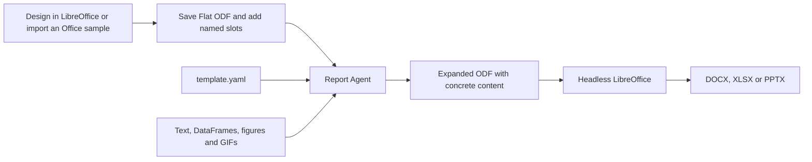

# Generate reports from LibreOffice templates

Report Agent can generate DOCX documents, XLSX workbooks and PPTX presentations
from reusable LibreOffice templates. You design the layout once, mark the places
where data belongs, then supply new text, tables and charts for each report.

This guide walks through that workflow, including how to reuse a branded Word
sample with headers, footers and logos. It describes the current implementation;
Office output is experimental, and conversion fidelity needs review in the apps
your recipients use.

## 1. Understand the template model

The approach is similar to the project's LaTeX workflow: a complete source file
owns the design, named placeholders receive runtime data, and an external engine
produces the final file.

| Responsibility | LaTeX/PDF | LibreOffice/Office |
| --- | --- | --- |
| Complete layout source | `.tex` | `.fodt`, `.fods` or `.fodp` |
| Placeholder syntax | `<<summary>>` | `<ra:text name="summary"/>` and other typed XML slots |
| Input declarations | Schema v1 metadata | Schema v2 metadata |
| Runtime content | Typed Python inputs or CLI files | Typed Python inputs or CLI files |
| Layout and styling | TeX commands and presentation metadata | ODF styles and structure in the source template |
| Output engine | TeX compiler | LibreOffice in headless mode |

**Flat ODF** means an OpenDocument file represented as a single XML document:

| Final report | Source template | Design application |
| --- | --- | --- |
| `.docx` | `.fodt` — Flat OpenDocument Text | LibreOffice Writer |
| `.xlsx` | `.fods` — Flat OpenDocument Spreadsheet | LibreOffice Calc |
| `.pptx` | `.fodp` — Flat OpenDocument Presentation | LibreOffice Impress |

These files contain the actual document design: text styles, tables, margins,
page styles, slide frames, sheet definitions and embedded images. There is no
separate Pandoc reference file or Markdown intermediate.



Template preparation is a one-time authoring step. Normal report generation
loads the prepared template and supplies fresh inputs. The current backend does
not apply Jinja loops, expressions or includes to Office XML. Repeated table rows
come from a DataFrame; page, slide and tab structure is authored in the template.

## 2. Set up and try a working report

Run commands from the repository root. Install the project's locked Python
dependencies and install LibreOffice separately:

```sh
uv sync --locked
soffice --version
```

`soffice` must be available on `PATH`. If it is installed elsewhere, configure its
executable explicitly as shown in section 10. Install the fonts used by your
template on the machine generating the report.

Start with the comprehensive examples:

```sh
uv run python examples/office_comprehensive/render.py
```

The command creates:

```text
output/office_comprehensive/
  comprehensive-document.docx
  comprehensive-presentation.pptx
  comprehensive-workbook.xlsx
  comprehensive-document.artifacts/
  comprehensive-presentation.artifacts/
  comprehensive-workbook.artifacts/
```

The document demonstrates portrait and landscape sections, headers and footers,
charts, styled tables and a long appendix. The presentation has nine explicitly
defined slides, including an animated chart. The workbook has seven named tabs,
typed data and cross-tab formulas.

Build just one format while adjusting its template:

```sh
uv run python examples/office_comprehensive/render.py --only docx
uv run python examples/office_comprehensive/render.py --only pptx
uv run python examples/office_comprehensive/render.py --only xlsx
```

Use the [example walkthrough](../examples/office_comprehensive/README.md) to find
the source for each page, slide and tab.

## 3. Prepare your own template

### Option A: adapt a working example

For a first DOCX report, copy the small example's source and metadata:

```sh
mkdir -p templates/monthly_report
cp examples/office_docx/main.fodt templates/monthly_report/main.fodt
cp examples/office_docx/template.yaml templates/monthly_report/template.yaml
```

That template already has three slots: `title`, `summary` and `sales`. Section 5
provides Python and CLI examples that work with this copy. Use the comprehensive
templates when you need a more developed design.

### Option B: design in LibreOffice

1. Create the document in Writer, Calc or Impress with representative sample
   content. Define typography, colors, table styles and document structure.
2. Put visible authoring markers such as `REPORT_TITLE_HERE` and
   `SALES_TABLE_HERE` at the intended insertion points.
3. Save as the corresponding **Flat XML ODF** format: FODT, FODS or FODP.
4. Open that XML in a text editor, add the `ra` namespace and replace the markers
   with real XML slot elements, as shown in section 4.
5. Add `template.yaml`, supply runtime inputs and generate the report.

The visible markers are only authoring aids. Report Agent does not search for
marker strings or convert them automatically. A marker can be split across text
spans when saved, so inspect the surrounding XML before replacing it.

Keep the original visual design file separately. After custom `ra` slots have
been added, saving the template through LibreOffice again may discard or alter
them. Make visual changes in the design original, export again, and deliberately
reapply the slots; use a source diff to review the change.

### Option C: reuse a branded DOCX sample

**Yes: a Word sample with mostly empty pages, styled headers/footers and logos can
be your starting point.** Convert it once into the FODT source this backend uses.
You do not need to manually redraw the design or extract every style into a
separate file.

```sh
mkdir -p templates/branded_report
soffice --headless \
  --convert-to "fodt:OpenDocument Text Flat XML" \
  --outdir templates/branded_report sample.docx
```

This produces `templates/branded_report/sample.fodt`. Set `entrypoint:
sample.fodt` in its metadata, or rename the file and use the new name. The filter
name and conversion syntax come from the
[LibreOffice conversion reference](https://help.libreoffice.org/latest/en-US/text/shared/guide/convertfilters.html).

Then prepare the converted design:

1. Inspect it in Writer before adding slots. Check logo placement, fonts,
   headers, footers, margins and section breaks; conversion may alter them.
2. Identify the page designs you need, such as cover, portrait body, landscape
   tables and appendix. Preserve intentional section changes.
3. Remove empty paragraphs and breaks whose only purpose was to manufacture
   blank sample pages. Retain the page styles carrying the design.
4. Replace sample body content with slots. Keep fixed branding in the template;
   use an image slot only when the logo must vary per report.
5. Make sure static images are embedded. The backend currently rejects nonempty
   `xlink:href` references, including hyperlinks and linked pictures, as well as
   embedded OLE objects. Converted documents may need cleanup before rendering.
6. Generate a report with realistic data and inspect the exported DOCX.

An empty Word page is not a named container into which the renderer inserts
content. Body content flows and paginates. Reuse its page design and intentional
section boundaries; section 6 explains how to request new pages.

Automatic DOCX import, cleanup and placeholder insertion are not implemented.
The conversion command is a manual preparation step. The same preparation idea
applies to spreadsheet and presentation samples using these filters:

```sh
soffice --headless \
  --convert-to "fods:OpenDocument Spreadsheet Flat XML" \
  --outdir templates/imported sample.xlsx
soffice --headless \
  --convert-to "fodp:OpenDocument Presentation Flat XML" \
  --outdir templates/imported sample.pptx
```

Create the destination directory first. Imported files still need slot authoring
and compatibility review; they are not automatically ready-to-use templates.

## 4. Connect XML slots, metadata and runtime values

Every visible input has three matching names:

| Location | Example |
| --- | --- |
| XML template | `<ra:text name="title"/>` |
| Metadata | `inputs.title` |
| Python input mapping | `"title": TextInput("Monthly review")` |

Names are case-sensitive and start with a letter, followed by letters, digits or
underscores. Keep the same spelling in all three places.

### Add the namespace and slots

Declare this namespace on the existing `office:document` root:

```xml
xmlns:ra="urn:report-agent:template:1"
```

For Writer, the following content goes inside `office:body/office:text`:

```xml
<text:h text:outline-level="1">
  <ra:text name="title"/>
</text:h>
<ra:paragraphs name="summary" style-name="ReportBody"/>
<ra:table name="sales"/>
```

`ReportBody` must be an existing paragraph style. It is defined in the small
DOCX example. XML snippets in this guide are fragments; preserve the complete
namespace declarations and surrounding document structure from the source file.

| Slot | Placement and purpose |
| --- | --- |
| `ra:text` | Inside `text:p`, `text:h` or `text:span`; inline plain text. Input line breaks are flattened to spaces. |
| `ra:paragraphs` | Directly inside Writer's `office:text`; blank lines separate paragraphs. |
| `ra:table` | Writer body for a native table; Impress table frame for a native slide table; Calc spreadsheet body for a complete data tab. |
| `ra:cell` | Directly inside a Calc `table:table-cell`; a dynamic literal text value. |
| `ra:image` | Inside a Writer paragraph/heading, or directly inside an Impress slide; PNG/JPEG or a Matplotlib Figure rendered as PNG. |
| `ra:animation` | Directly inside an Impress slide; an embedded animated GIF. |

Text inputs are literal content. Markdown, HTML, XML and TeX within a string do
not become formatting. Define rich styling in the template, and use separate
styled spans/slots when different pieces of text need different appearances.

### Declare the inputs

For the three-slot DOCX template, use this `template.yaml`:

```yaml
schema_version: 2
id: monthly_report
entrypoint: main.fodt
document:
  engine: libreoffice
  format: docx
inputs:
  title:
    type: text
    max_chars: 120
  summary:
    type: text
    max_chars: 2000
  sales:
    type: table
```

Change both `format` and the entrypoint extension for another output: `xlsx` with
`.fods`, or `pptx` with `.fodp`. The requested output filename must also match.

Text inputs may have a `default`; inputs can be optional with `required: false`.
An omitted optional slot is removed, but surrounding headings, frames and page
breaks remain. This is not a conditional section feature.

Layout belongs in the XML. Schema v2 does not accept the LaTeX metadata's styling
fields such as `preset`, `longtable` or TeX image widths.

## 5. Generate the report

### Python API

Save the following as `generate_monthly_report.py` in the repository root, after
copying the template from section 3:

```python
from pathlib import Path

import pandas as pd

from report_agent import RenderRequest, TableInput, TextInput, create_renderer

bundle = Path("templates/monthly_report")
sales = pd.DataFrame(
    {
        "Region": ["EMEA", "APAC", "AMER"],
        "Revenue": [1320.5, 930.25, 1650.0],
    }
)

result = create_renderer().render(
    RenderRequest(
        template=bundle,
        metadata=bundle / "template.yaml",
        inputs={
            "title": TextInput("Monthly sales review"),
            "summary": TextInput(
                "Total revenue was 3,900.75.\n\n"
                "AMER contributed the largest regional total."
            ),
            "sales": TableInput(sales),
        },
        output=Path("output/monthly-report.docx"),
    )
)

for issue in result.diagnostics:
    print(issue.severity, issue.stage, issue.code, issue.message)

if result.output_path is None:
    raise SystemExit("Report generation failed; inspect the diagnostics.")

print(f"Created {result.output_path}")
```

Run it:

```sh
uv run python generate_monthly_report.py
```

For Office jobs, check `result.output_path`. A successful Office build currently
includes an `experimental_backend` warning, so the presence of diagnostics alone
does not mean it failed.

### CLI and file inputs

For the same template, save a CSV as `data/sales.csv`:

```csv
Region,Revenue
EMEA,1320.5
APAC,930.25
AMER,1650.0
```

Then run:

```sh
uv run report render templates/monthly_report \
  --metadata templates/monthly_report/template.yaml \
  --text 'title=Monthly sales review' \
  --text 'summary=Total revenue was 3,900.75.' \
  --table sales=data/sales.csv \
  --output output/monthly-report.docx
```

For many inputs, use a YAML manifest. Save this as `data/monthly-inputs.yaml`
beside `sales.csv`:

```yaml
inputs:
  title: Monthly sales review
  summary:
    type: text
    text: |
      Total revenue was 3,900.75.

      AMER contributed the largest regional total.
  sales:
    type: table
    path: sales.csv
```

```sh
uv run report render templates/monthly_report \
  --metadata templates/monthly_report/template.yaml \
  --inputs data/monthly-inputs.yaml \
  --input-root data \
  --output output/monthly-report.docx
```

Manifest paths are relative to the manifest file. Explicit flag paths are
relative to the working directory. Explicit flags override manifest values.
`--input-root` restricts referenced asset paths to that directory.

### Add a logo or a static plot

Add these declarations to metadata, matching new slots in the template:

```yaml
  logo:
    type: image
  trend:
    type: graph
```

For Writer, place the slots inside paragraphs:

```xml
<text:p><ra:image name="logo" width="3cm" height="1.2cm"/></text:p>
<text:p><ra:image name="trend" width="16cm" height="7cm"/></text:p>
```

Add the corresponding values to the Python `inputs` mapping:

```python
from matplotlib.figure import Figure
from report_agent import FigureInput, ImageInput

figure = Figure(figsize=(8, 3.5))
axis = figure.subplots()
axis.plot(["July", "August", "September"], [1100, 1250, 1550], marker="o")
axis.set_ylabel("Revenue")
figure.tight_layout()

extra_inputs = {
    "logo": ImageInput(Path("assets/logo.png")),
    "trend": FigureInput(figure),
}
```

Merge `extra_inputs` into the mapping passed to `RenderRequest`; the standalone
assignment above does not alter the earlier request. Keep asset files available
until rendering returns. `GraphInput(Path("assets/trend.png"))` can supply an
existing chart instead. Office image slots accept PNG/JPEG; convert PDF graphics
before supplying them. Images use aspect-preserving contain fitting.

## 6. Define DOCX pages, headers and footers

Writer combines three parts:

1. A **page layout** specifies paper dimensions and margins.
2. A **master page** associates that layout with headers and footers.
3. A **paragraph style** can request a new page and select a master page.

LibreOffice's [page style documentation](https://help.libreoffice.org/latest/en-US/text/swriter/guide/pagestyles.html)
describes how page styles control orientation, margins, headers and footers.
The report template uses the corresponding ODF structures.

For an A4 body page, define this in `office:automatic-styles`:

```xml
<style:page-layout style:name="BodyLayout">
  <style:page-layout-properties
      fo:page-width="21cm" fo:page-height="29.7cm"
      fo:margin-left="2cm" fo:margin-right="2cm"
      fo:margin-top="2cm" fo:margin-bottom="2cm"/>
</style:page-layout>
```

Bind it in `office:master-styles`:

```xml
<style:master-page style:name="Standard" style:page-layout-name="BodyLayout">
  <style:header>
    <text:p>COMPANY NAME — MONTHLY REVIEW</text:p>
  </style:header>
  <style:footer>
    <text:p>
      Page <text:page-number text:select-page="current">1</text:page-number>
    </text:p>
  </style:footer>
</style:master-page>
```

Keep a fixed logo embedded in the header if it should repeat. A runtime logo slot
can instead appear inside a header's `text:p`. Reserve enough header/footer space
in the page layout; the comprehensive source demonstrates those properties.

To start a new body page without changing the master, add this paragraph style
in `office:styles`:

```xml
<style:style style:name="NewPageHeading" style:family="paragraph">
  <style:paragraph-properties fo:break-before="page" fo:keep-with-next="always"/>
  <style:text-properties fo:font-size="20pt" fo:font-weight="bold"/>
</style:style>
```

Apply it to a later section heading:

```xml
<text:h text:outline-level="1" text:style-name="NewPageHeading">
  Regional performance
</text:h>
<ra:table name="sales"/>
```

For a landscape section, define a landscape page layout and master, then add
`style:master-page-name="Landscape"` to the section-start paragraph style. Select
a portrait master on a later section heading to return to portrait. See the
[complete page-style examples](office-template-authoring.md#docx-pages-and-sections).

**Avoid a forced break before the first content.** The comprehensive template
uses `Standard` as the initial master; its first paragraph style has
`fo:break-before="auto"` and no master-page reassignment. A custom master selected
on that first paragraph previously exported a leading break and caused an empty
first page in some viewers. Explicit breaks and master changes belong at later
section boundaries.

You can request where a section starts, but its length still depends on content
and fonts. A long native table may span several pages, with repeated headers.
Keep total column width within the usable page width. For precise page-by-page
design, bound the content length and verify every generated page.

## 7. Define PPTX slides and animations

One `draw:page` inside `office:presentation` is one slide. XML order is slide
order. The template's page layout sets the canvas size; the comprehensive deck
uses `33.867cm` by `19.05cm` for 16:9.

Here is a slide fragment using its existing `Standard` master and `SlideTitle`
paragraph style:

```xml
<draw:page draw:name="Revenue trend" draw:master-page-name="Standard">
  <draw:frame draw:name="revenue-title"
      svg:x="1.8cm" svg:y="1cm" svg:width="30cm" svg:height="2cm">
    <draw:text-box>
      <text:p text:style-name="SlideTitle"><ra:text name="title"/></text:p>
    </draw:text-box>
  </draw:frame>
  <ra:image name="trend"
      x="1.8cm" y="4cm" width="29cm" height="12cm"/>
</draw:page>
```

Frame coordinates are measured from the top-left corner. Native frame attributes
use `svg:x`/`svg:y`; Report Agent image/animation slots use `x`/`y`. Images and
animations create their own frame and belong directly under `draw:page`.

Text goes in a `draw:text-box`. A table slot goes in a positioned `draw:frame`.
To preserve native table header/banding colors, use the named Impress table
template illustrated in the [authoring reference](office-template-authoring.md#preserve-native-table-colors).

Add or reorder slides by adding or moving whole `draw:page` elements. The current
renderer does not automatically split overflowing text or tables into new slides.

### Embed a generated dynamic chart

For an animated chart, use this slot instead of the static image slot:

```xml
<ra:animation name="sales_animation"
    x="1.8cm" y="4cm" width="29cm" height="12cm"
    start="automatic" loop="true"/>
```

Its metadata can declare a generator and the table it consumes:

```yaml
inputs:
  sales_data:
    type: table
    visible: false
  sales_animation:
    type: animation
    source: generator
    generator: sales_over_time
    uses: [sales_data]
    export:
      format: gif
      fps: 4
      duration_seconds: 3
      width_px: 600
      height_px: 300
```

The application registers `sales_over_time` and provides a data-source adapter in
`ContentResolver`. Pass it to `create_renderer(resolver=...)`, and supply query
bindings through `RenderRequest.queries`. Rendering performs the sequence:

1. Fetch a bounded DataFrame through the application-owned adapter.
2. Pass that data to a registered Matplotlib animation function.
3. Export the animation as a finite GIF and a PNG poster.
4. Expand the FODP slot and convert the deck to PPTX.
5. Verify that media reachable through slides, layouts or masters contains the
   original animated GIF.

The [runnable animation example](../examples/office_pptx/render.py) implements all
five steps. Its generator produces 12 frames for 4 fps × 3 seconds. In general,
provide exactly `ceil(fps * duration_seconds)` frames. The renderer owns the
temporary media workspace through conversion and cleans it afterward. If you
call `resolver.resolve(...)` separately, keep its workspace alive through rendering.

If you already have a looping GIF, declare an ordinary `type: animation` input
and supply `AnimationInput(Path("chart.gif"), Path("poster.png"))`; omit the
generator-specific metadata. The CLI also accepts `--animation NAME=PATH`.

The recipient receives an embedded animation. Python and data fetching happen at
build time; the chart does not query data or offer live interaction during the
presentation. Rebuild the report to update it.

The current insertion path supports automatic, looping GIFs. MP4 insertion,
on-click playback and native PowerPoint object effects are not implemented.
Review animation playback in the target PowerPoint's Slide Show mode; package
checks and PDF previews cannot prove playback. See the
[animation limits](office-reports.md#animation-generation) before increasing
duration, frame rate or resolution. Generated animations currently require a
dedicated single-threaded macOS/Linux worker.

## 8. Define XLSX tabs, formulas and formatting

A `table:table` directly under `office:spreadsheet` defines a template-owned tab.
Its `table:name` is the visible tab name. A top-level `ra:table` creates a complete
tab from a DataFrame. Their XML order determines tab order.

This fragment creates a Summary tab followed by a dynamic Sales tab:

```xml
<office:spreadsheet>
  <table:table table:name="Summary">
    <table:table-row>
      <table:table-cell office:value-type="string">
        <text:p>Total revenue</text:p>
      </table:table-cell>
      <table:table-cell office:value-type="float"
          table:formula="of:=SUM([Sales.B2:Sales.B4])"/>
    </table:table-row>
  </table:table>
  <ra:table name="sales" sheet-name="Sales" max-rows="100" max-columns="10"/>
</office:spreadsheet>
```

Declare `xmlns:of="urn:oasis:names:tc:opendocument:xmlns:of:1.2"` on the root for
these ODF formulas. With the section 5 DataFrame, Sales row 1 contains column
labels and rows 2–4 contain the three regional records. Summary B1 evaluates to
3,900.75. Change the formula range when the data shape changes: the renderer does
not rewrite references automatically, and this fixed range covers only three rows.

Use a scalar slot for a dynamic text label in a template-owned cell:

```xml
<table:table-cell office:value-type="string">
  <ra:cell name="period"/>
</table:table-cell>
```

Declare `period` as `type: text` and supply `TextInput("September 2026")`. Numeric
data enters through typed DataFrame tables or template-authored numeric cells;
`ra:cell` currently inserts text, not a numeric scalar.

Practical rules for workbook templates:

- A dynamic table slot owns a complete sheet. It does not fill an arbitrary cell
  range or shift surrounding cells/formulas.
- Tab names must be unique. Update formula references when renaming a tab.
- `max-rows` bounds data rows, excluding the generated header. Exceeding the
  capacity fails rather than silently truncating data.
- DataFrame column order becomes sheet column order. The index is not emitted;
  turn meaningful index labels into columns first. MultiIndex is unsupported.
- Keep numeric values numeric. Apply cell number styles for currency, decimals
  and percentages; strings such as `"$1,200"` will remain text.
- Missing values represented by `None`, `pd.NA` or `pd.NaT` become blank cells.
  Normalize floating NaN/infinity before rendering; nonfinite numbers are rejected.
- Long numeric identifiers exceeding 15 integer digits should be strings.
  Normalize timezone-aware datetimes explicitly before rendering.
- Runtime strings beginning with `=` stay text. Formulas belong in trusted
  template cells and are recalculated by Calc during conversion.

The tested formula subset includes SUM, COUNTA and arithmetic, including
references to later tabs. Complex Excel formulas need their own compatibility
checks. Editable native chart generation and automatic formula-range rewriting
are outside the current implementation.

Column widths and numeric styles belong in ODF styles. Per-column table styling
attributes must contain one style name per DataFrame column. For full examples,
see [XLSX tab authoring](office-template-authoring.md#xlsx-tabs) and the
[comprehensive workbook source](../examples/office_comprehensive/xlsx/main.fods).
Print page styles affect printing/export; they do not create additional tabs.

## 9. Keep data preparation separate from layout

The application prepares values, and the template decides where they appear.
A useful project structure is:

```text
templates/
  monthly_docx/
    main.fodt
    template.yaml
  monthly_pptx/
    main.fodp
    template.yaml
  monthly_xlsx/
    main.fods
    template.yaml
data/
  sales.csv
  monthly-inputs.yaml
generate_monthly_report.py
output/
```

Each output format has its own layout template and metadata. They can share the
same prepared business data. A Word layout cannot simply be renamed to become a
slide deck or workbook.

Start with direct `TextInput`, `TableInput` and `FigureInput` values. Add
`ContentResolver` through `create_renderer(resolver=...)` when the application
needs query-backed tables, generated summaries or animations. Queries are supplied
through `RenderRequest.queries`; implementations live in application code. A slot
does not execute SQL or Python. The CLI accepts `--resolver module:factory` and
`--queries queries.yaml` for the same path. See the
[content resolution guide](content-resolution.md) for wiring and adapter contracts.

For generated summaries, v2 metadata supports text with `source: agent`, a
`prompt`, table dependencies in `uses`, and `max_chars`. The application must
provide the text generator. Hidden tables must be consumed by an agent or
animation generator; they have no visible XML slot.

## 10. Configure LibreOffice and inspect results

If `soffice` is not on `PATH`, inject a configured converter:

```python
from report_agent import create_renderer
from report_agent.backends.libreoffice import LibreOfficeBackend
from report_agent.compilation.libreoffice import LibreOfficeConverter

renderer = create_renderer(
    office_backend=LibreOfficeBackend(
        converter=LibreOfficeConverter(
            executable="/Applications/LibreOffice.app/Contents/MacOS/soffice",
            timeout_seconds=120,
        )
    )
)
```

Use `renderer.render(...)` for subsequent requests. Each conversion uses its own
temporary LibreOffice profile and captures logs. Use distinct output stems for
concurrent builds: `report.docx` and `report.pptx` would share `report.artifacts`.

A successful DOCX build retains files like:

```text
output/
  monthly-report.docx
  monthly-report.artifacts/
    expanded.fodt
    build.json
    export/
      conversion.log
      version.txt
    report-assets/
      ...staged media when present...
```

`expanded.fodt` shows the exact source after slot replacement. `build.json`
records the engine/version, output format, source hash and animation metadata
when applicable. Each artifact publication replaces the previous directory as a
complete snapshot, so old hash-named media and failure logs do not accumulate.
If staging the replacement fails, the previous snapshot remains intact.
Conversion logs explain engine failures. Early validation errors
may occur before artifacts exist. A failed build preserves the previous final
report; do not mistake an older file on disk for a successful current build.

Review the generated Office file, not just its XML. Check the first page, section
transitions, long-table continuation, logo position, slide text fit, workbook
values and number formats. Open the native file in the recipient's application
for the final compatibility check. A static preview cannot validate animation.

The backend currently reports experimental compatibility status. Local checks
have used LibreOfficeDev 26.8; a released-version baseline and desktop Office
playback verification remain outstanding. See the
[backend status](office-reports.md#verification-status) for the current boundary.

## 11. Troubleshoot common problems

| Symptom | What to inspect or change |
| --- | --- |
| Blank first DOCX page | Remove a leading forced break or inherited page-break style; avoid assigning a different master on the first paragraph. See section 6. |
| Extra blank pages after importing a sample | Inspect empty paragraphs, manual/section breaks and odd/even-page requirements. Keep intentional section changes. |
| Logo or header shifts | Compare the imported FODT with the original; check anchors, embedded image data, margins and installed fonts. |
| `External template references are unsupported` | Inspect `xlink:href`, including hyperlinks and linked graphics; embed supported images and remove unsupported links. |
| `undeclared_placeholder` or `unused_input` | Match XML slot names with visible metadata input names. |
| `missing_input`, `input_type` or `text_length` | Supply the required typed value or a valid default; respect text limits. |
| `invalid_slot` | Match the slot kind to the metadata type, such as `ra:image` for `graph`. |
| Missing style or unexpected table formatting | Define referenced styles in the correct ODF section; use the Impress table template for slide-table fills. |
| Text or table extends off a slide | Reduce or split the content explicitly, or adjust frame geometry; no automatic slide pagination is implemented. |
| XLSX summary is wrong | Inspect formula syntax, range size, tab names and supported functions; compare with source data. |
| XLSX totals are text | Supply numeric DataFrame values and use number styles for display formatting. |
| `converter_not_found` or `converter_timeout` | Check the executable path and retained conversion log; review document size and timeout configuration. |
| Animation fails preservation checks | Inspect the source GIF and conversion log; the output must retain its original bytes as slide-referenced media. |
| GIF looks static in a preview | Check the native PPTX in Slide Show mode; the preview only shows a frame. |

For deeper XML examples, continue with the
[template authoring reference](office-template-authoring.md). For runnable designs,
use the [comprehensive examples](../examples/office_comprehensive/README.md).
