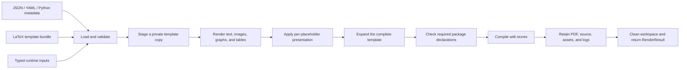

# Project overview

Report Agent compiles complete LaTeX templates into PDF reports. Callers supply
JSON/YAML metadata (or a Python mapping/model) and typed runtime content: text,
images, graph files, matplotlib figures, and pandas DataFrames.

This is the current architecture reference. Detailed examples live in the
[comprehensive walkthrough](comprehensive-example-walkthrough.md) and
[placeholder style guide](placeholder-styles.md). The
[table layout proposal](table-layout-design.md) describes future column splitting
and automatic width/orientation policies; those policies are not implemented.

## Rendering contract

| Input | Responsibility |
| --- | --- |
| Template bundle | Complete `.tex` structure, static content, fonts, packages, and local resources |
| Metadata | Named input types, defaults, limits, graphics widths, table presets, compiler engine, and per-placeholder styles |
| Runtime content | Actual strings, image/graph paths, Figure objects, and DataFrames for one report |

The template key `<<summary>>` maps to `inputs.summary`. Its content strategy
prepares the value; the presentation layer applies `inputs.summary.style`; Jinja
inserts the resulting fragment into the complete document.



## Package structure

Package `__init__.py` files are omitted for readability.

```text
src/report_agent/
├── __init__.py                  # Public Python API exports
├── __main__.py                  # python -m report_agent
├── application/
│   ├── request.py               # One invocation
│   ├── service.py               # ReportRenderer orchestration
│   ├── validation.py            # Template/input compatibility
│   └── bootstrap.py             # Default dependency composition
├── models/
│   ├── inputs.py                # Typed caller values
│   ├── results.py               # Fragments, diagnostics, build results
│   └── template.py              # Template bundle and render context
├── metadata/
│   ├── models.py                # Shared metadata schema
│   ├── styles.py                # Presentation schema
│   ├── dimensions.py            # Supported dimensions
│   ├── parsers.py               # JSON/YAML format strategies
│   └── loader.py                # Format selection and schema validation
├── templates/
│   ├── repository.py            # Local bundle discovery
│   └── engine.py                # Jinja expansion and dependency inspection
├── rendering/
│   ├── base.py                  # ContentRenderer protocol
│   ├── registry.py              # Type/backend-to-strategy selection
│   ├── latex.py                 # Plain-text escaping
│   ├── assets.py                # Graphics validation/staging
│   ├── text.py
│   ├── images.py
│   ├── tables.py
│   └── graphs/
│       ├── renderer.py
│       └── adapters.py          # Figure export
├── presentation/
│   └── styler.py                # Shared scoped style application
├── compilation/
│   ├── base.py                  # LatexCompiler protocol
│   ├── texres.py                # Process lifecycle
│   └── diagnostics.py           # Warnings and table overflow attribution
├── validation/
│   ├── text.py                  # Shared plain-text validation policy
│   └── packages.py              # Template package declaration scanner
├── resolution/                 # Optional pre-render content preparation
│   ├── interfaces.py            # DataSource / AgentTextGenerator protocols
│   ├── models.py                # Query bindings, bounded summaries, results
│   └── resolver.py              # Resolve tables before dependent agent text
├── storage/
│   ├── workspace.py            # Temporary resource lifetime
│   └── artifacts.py            # Retained file publication
└── interfaces/
    └── cli/
        ├── app.py              # Typer adapter
        └── inputs.py           # JSON/YAML manifests and CSV/Parquet loading
```

## Objects and dependency direction

| Package | Main objects | Responsibility |
| --- | --- | --- |
| `application` | `ReportRenderer`, `RenderRequest`, `RenderValidator` | Coordinate one build; retain no per-request instance state |
| `models` | `TextInput`, `ImageInput`, `GraphInput`, `FigureInput`, `TableInput`, `TemplateBundle`, `RenderContext`, `RenderedContent`, `CompileResult`, `RenderResult`, `Diagnostic` | Shared typed values, with no file/process operations |
| `metadata` | `TemplateMetadata`, `InputDefinition`, `CompilerOptions`, `PlaceholderStyle`, `MetadataLoader`, parser strategies | Validate metadata independently of its serialization format |
| `templates` | `TemplateRepository`, `LocalTemplateRepository`, `TemplateEngine`, `JinjaTemplateEngine` | Resolve a bundle; inspect static dependencies; expand the full document |
| `rendering` | `ContentRenderer`, `RendererRegistry`, concrete content strategies | Convert typed input to trusted LaTeX and staged graphics |
| `presentation` | `PlaceholderStyler`, `LatexPlaceholderStyler` | Apply typography, headings, alignment, spacing, page breaks, and single-page boxes |
| `compilation` | `LatexCompiler`, `TexresCompiler` | Run the selected engine with private output/cache, timeout, and structured diagnostics |
| `validation` | `TemplatePackageScanner`, shared text policy | Check required declarations and reuse plain-text rules |
| `resolution` | `ContentResolver`, `DataSource`, `AgentTextGenerator`, `QuerySource` | Optionally prepare tables and agent text before the render request |
| `storage` | `WorkspaceManager`, `TemporaryWorkspaceManager`, `ArtifactStore`, `LocalArtifactStore` | Own temporary staging and retain finished artifacts |
| `interfaces` | Typer `app` | Adapt CLI arguments/results to the core API |

Replaceable boundaries use `typing.Protocol`. `ReportRenderer` receives its
collaborators through constructor injection. `create_renderer()` selects default
implementations in the composition root, so ordinary Python callers do not have
to assemble them individually.

Shared models do not depend on application or CLI code. Content strategies,
compilation, templates, presentation, and storage do not import the facade.
The application composes these services; interfaces call it.

## Build lifecycle

1. Parse selected metadata into one schema. Reject malformed input, duplicate
   mapping keys, unsupported options, and ambiguous types.
2. Discover the entrypoint and non-hidden bundle files. Reject parent traversal
   and symlink resources. Generated `*.artifacts` directories are not staged.
3. Validate placeholder declarations, supplied names/types, defaults, text limits,
   and availability of every declared renderer backend, including omitted inputs.
4. Enter an isolated workspace and copy template resources.
5. Resolve defaults and optional values, render each visible input, and apply its
   style. Context-only (`visible: false`) inputs are not converted or inserted.
6. Expand Jinja once, validate required package declarations, and write the complete
   `.tex` source. Tables carry source markers for overflow attribution.
7. Compile with a bounded texres process. On cancellation/timeout, stop its process
   group where supported. Inspect exit status, PDF presence/signature, and warnings.
   Attributed table width overflow above `compiler.table_overflow_tolerance_pt`
   (default 2pt) is an error and prevents PDF publication; smaller values warn.
8. Retain expanded source at its original bundle-relative path, plus supported
   resources, graphics, and logs. Refuse PDF output and artifact paths that
   overwrite source resources. PDF output collisions fail before staging.
9. Publish the final PDF only on success, then clean the workspace.

`RenderResult.pdf_path` is `None` on failure. Diagnostics include stage, code,
message, and input name where applicable. Compiler failures retain available
source/logs/assets and preserve any previous destination PDF. Early validation
failures may have diagnostics without retained files.

## Current behavior and boundaries

- Metadata supports JSON, YAML, and Python mappings/models with the same semantics.
- Text is escaped plain text. Markdown and user-provided LaTeX are not interpreted.
- Graphics support PNG/JPEG/PDF files and live matplotlib figures. Export preserves
  figure dimensions and axes layout; drawing can populate Matplotlib caches.
- Tables support financial/comparison presets, sequential/diverging heatmaps,
  MultiIndex labels, missing values, precision, hidden indices, and longtable.
  Omitted precision preserves numeric precision. The default `styler` backend is
  implemented; `great_tables` has a registry boundary but no bundled adapter.
- Placeholder styles support inline/block typography, headings, spacing,
  alignment, explicit page transitions, and unbreakable single-page containers.
- Page/section structure and required packages remain template responsibilities.
  Fragment requirements are checked against literal template declarations and
  `provided_packages` before compilation; packages are not injected automatically.
  The scanner follows local TeX/style/class dependencies but is not a TeX interpreter.
- Templates are trusted document sources. Text escaping and disabled shell escape
  do not constitute complete operating-system isolation for arbitrary templates.
- Each call has a private workspace. Thread safety, concurrent throughput, and
  matplotlib concurrency have not been established by the sequential benchmark.

The Python API supports all content types. The CLI accepts repeated `--text`,
`--table` (CSV/Parquet), `--image`, and `--graph` assignments, or JSON/YAML
`--inputs` manifests. Manifest paths are relative to the manifest; explicit flags
override its values. Parquet requires the optional `parquet` extra.

## Examples, checks, and future work

- [Plain text](../examples/plain_text/render.py): minimal defaults and escaping.
- [Comprehensive report](../examples/comprehensive/README.md): charts, six tables,
  heatmaps, grouped rows, and a paginated appendix.
- [Rotated tables](../examples/rotated_tables/README.md): explicit landscape and
  sideways placement in a template.
- [Placeholder styles](../examples/placeholder_styles/README.md): one style lookup
  mechanism for every content type.
- [Benchmark](../benchmarks/README.md): repeatable sequential wall-time measurement.

Unit tests cover metadata, input/style validation, content conversion, template
inspection, publication, and process failures. Integration tests compile PDFs and
check extracted content/pagination when texres and Poppler are available.

Column layout planning is specified separately in the table layout proposal.
The optional [content resolver](content-resolution.md) exposes injected data-source
and text-generator interfaces, bounded summaries, and dependency ordering.
`GenerationRequest` carries the character limit and length-retry feedback.
Opt-in raw rows share an 8,192-character budget per request; unreferenced hidden
inputs are rejected by metadata. Live
database/model adapters and HTTP/job services remain future integrations. Business
calculations and model invocation belong to application-owned adapters. See
[review hardening](review-hardening.md) for the package, CLI, and diagnostic contracts.
