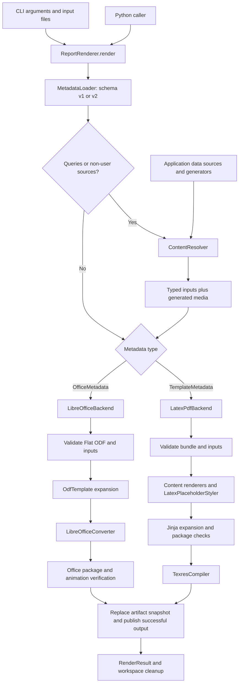
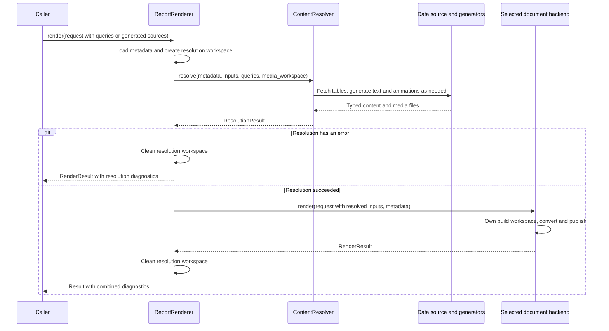

# Architecture and build lifecycle

Report Agent has one public render API and two document backends. Schema v1
selects LaTeX/PDF; schema v2 selects LibreOffice/DOCX, XLSX or PPTX. Both accept
named typed inputs, can resolve application-provided queries and generators, and
return a `RenderResult` with diagnostics and retained artifacts.

This reference describes the current code. Start with the
[README](../README.md) for commands or the
[LibreOffice tutorial](libreoffice-template-guide.md) for template authoring.

## End-to-end architecture

Errors stop the relevant path and return diagnostics instead of publishing a new
final report. Backend input validation occurs after optional resolution, so
application data/model adapters may run before a template mismatch is discovered.
No database driver or model client is bundled.

## Public contracts

| Contract | Fields and behavior |
| --- | --- |
| [RenderRequest](../src/report_agent/application/request.py) | `template`, `metadata`, `inputs`, `output`, and optional `queries`; represents one invocation |
| [TemplateMetadata](../src/report_agent/metadata/models.py) | Schema v1: TeX entrypoint, compiler settings, input declarations and LaTeX presentation options |
| [OfficeMetadata](../src/report_agent/metadata/office.py) | Schema v2: explicit LibreOffice engine, format, matching Flat ODF entrypoint and input declarations |
| [Typed inputs](../src/report_agent/models/inputs.py) | `TextInput`, `TableInput`, `ImageInput`, `GraphInput`, `FigureInput`, `AnimationInput` |
| [QuerySource](../src/report_agent/resolution/models.py) | Named connection, query, parameters and row limit; application adapters execute it |
| [RenderResult](../src/report_agent/models/results.py) | `output_path`, `output_format`, diagnostics and retained artifact paths; `pdf_path` is a PDF compatibility alias |
| [Diagnostic](../src/report_agent/models/results.py) | `stage`, `code`, `message`, `severity`, and optional `input_name` |

Use `result.output_path is None` to detect failure for any format. A successful
Office result has `pdf_path=None`, so that field is not a generic success check.
Office success currently includes an `experimental_backend` warning.

Metadata file parsing accepts JSON/YAML with duplicate-key rejection. Python
mappings and validated metadata models use the same schema selection. Input
names connect runtime values to `<<name>>` in TeX or named `ra` XML slots in ODF.

## Composition and module ownership

[create_renderer](../src/report_agent/application/bootstrap.py) assembles the
facade, PDF collaborators and shared workspace/artifact services. It accepts
`resolver=ContentResolver(...)` and `office_backend=...` overrides. The facade
constructs its default `LibreOfficeBackend` once, so repeated renders reuse its
converter and cached version probe.

| Module | Ownership |
| --- | --- |
| [application/service.py](../src/report_agent/application/service.py) | `ReportRenderer`: metadata loading, optional resolution, backend selection, resolution-workspace lifetime |
| [application/backends.py](../src/report_agent/application/backends.py) | `DocumentBackend` protocol: `render(request, metadata) -> RenderResult` |
| [backends/latex_pdf.py](../src/report_agent/backends/latex_pdf.py) | `LatexPdfBackend`: PDF validation, resource staging, content/style preparation, TeX expansion, compilation and publication |
| [backends/libreoffice.py](../src/report_agent/backends/libreoffice.py) | `LibreOfficeBackend`: Office bundle checks, slot/input validation, ODF expansion, conversion, package verification and publication |
| [metadata/loader.py](../src/report_agent/metadata/loader.py) | File parser selection and schema-v1/v2 dispatch |
| [resolution/resolver.py](../src/report_agent/resolution/resolver.py) | Queries first, then agent text, then animations; preserves supplied overrides |
| [resolution/animations.py](../src/report_agent/resolution/animations.py) | Trusted animation registry, owned worker/encoder lifetime, finite frame export and poster generation |
| [application/validation.py](../src/report_agent/application/validation.py) | `RenderValidator`: PDF placeholder/type/backend validation; Office uses its backend's `_validate` |
| [templates/repository.py](../src/report_agent/templates/repository.py) | `LocalTemplateRepository`: TeX bundle discovery and path checks |
| [templates/engine.py](../src/report_agent/templates/engine.py) | `JinjaTemplateEngine`: TeX placeholder/dependency inspection and expansion |
| [templates/odf.py](../src/report_agent/templates/odf.py) | `OdfTemplate`: XML parsing, slot placement, native tables, image embedding, styles and formula-cache clearing |
| [rendering/registry.py](../src/report_agent/rendering/registry.py) | PDF content strategy selection by `(type, backend)` |
| [presentation/styler.py](../src/report_agent/presentation/styler.py) | `LatexPlaceholderStyler`: PDF-only presentation wrappers and their package requirements |
| [compilation/texres.py](../src/report_agent/compilation/texres.py) | `TexresCompiler`: process lifecycle, PDF checks and TeX diagnostics |
| [compilation/libreoffice.py](../src/report_agent/compilation/libreoffice.py) | `LibreOfficeConverter`: cached version probe, private profile/environment, conversion filters, timeout/cancellation |
| [validation/text.py](../src/report_agent/validation/text.py) | Shared text type/length/XML 1.0 character policy |
| [validation/packages.py](../src/report_agent/validation/packages.py) | PDF package declaration scanning |
| [storage/workspace.py](../src/report_agent/storage/workspace.py) | Temporary directories and cleanup |
| [storage/artifacts.py](../src/report_agent/storage/artifacts.py) | `LocalArtifactStore` file replacement and `publish_snapshot` artifact-directory replacement |
| [interfaces/cli/app.py](../src/report_agent/interfaces/cli/app.py) | CLI options, render invocation, diagnostics and exit codes |
| [interfaces/cli/inputs.py](../src/report_agent/interfaces/cli/inputs.py) | Runtime manifests, CSV/Parquet and file-backed input loading |
| [interfaces/cli/resolution.py](../src/report_agent/interfaces/cli/resolution.py) | Explicit resolver-factory imports and query-file parsing |

The Office backend expands ODF directly. It does not route through the TeX
renderer registry, `RenderedContent`, Jinja or `LatexPlaceholderStyler`.
`MatplotlibFigureExporter` is reused to produce PNG for Office and PDF for TeX.

The CLI calls the same facade as Python. Backends own format-specific behavior;
content, converter and storage collaborators do not call back into the facade.
`DocumentBackend`, PDF rendering/compiler interfaces, storage interfaces and
query/text adapters use protocols. The resolver itself is supplied as a
`ContentResolver`; animation functions are registered by name in application code.

## Resolution and generated-media lifetime

Resolution runs when `RenderRequest.queries` is nonempty or metadata contains any
`source: agent` / `source: generator` declaration. The default resolver has no
external adapters. An unsupplied generated input therefore needs a configured
resolver; otherwise it returns a named `resolution_failed` diagnostic.

1. Resolve query bindings into `TableInput` objects. A supplied value and query
   for the same name conflict; result row limits are checked.
2. For each unsupplied agent input, summarize only its declared `uses` tables,
   then call `AgentTextGenerator.generate(GenerationRequest)`. A text-length
   violation permits one retry. Invalid text fails without a length retry.
3. For each unsupplied animation input, call the registered generator with copied
   table data and bounded export options. The owned worker returns an
   `AnimationInput` pointing to encoded media and a PNG poster.
4. Pass the resolved mapping to the selected backend. Error diagnostics prevent
   backend execution; caller-supplied agent/animation values bypass generation.

The resolution workspace outlives the backend's conversion and artifact copying.
The backend also owns a separate build workspace. Explicit `resolver.resolve()`
is supported, but then the caller must keep its media workspace alive through
rendering. Query timeouts, access control and read-only credentials belong to the
data-source adapter. Summary sampling limits do not constrain SQL execution cost.
See [resolution contracts](content-resolution.md) for exact limits and CLI wiring.

## PDF backend lifecycle

1. Load the complete TeX bundle and check the PDF destination against resources.
   Discover non-hidden files; reject symlink resources and entrypoint traversal.
2. Validate placeholders, declared and supplied names, types, defaults, text policy
   and registry availability, including declarations with omitted optional values.
3. Create a build workspace and copy the bundle into a private `template/` tree.
4. For each visible input, select supplied/default/optional content, invoke its
   content renderer, then apply `LatexPlaceholderStyler`. Hidden context inputs
   are validated but are not rendered or staged as report content.
5. Expand Jinja, check fragment package requirements against template declarations
   and `provided_packages`, and write the staged entrypoint.
6. Run texres with bounded lifetime. Check output signature/presence and classify
   compiler diagnostics. Attributed table overflow above the configured tolerance
   prevents PDF publication.
7. Replace the artifact snapshot with expanded source, supported resources,
   generated graphics and available logs. Publish the PDF only on success, then
   clean the build workspace.

Content strategies return `RenderedContent` containing trusted TeX, staged assets
and package requirements. `CompileResult` is the PDF compiler's intermediate
result; it is separate from the public, format-neutral `RenderResult`.

## Office backend lifecycle

1. Check the bundle, format-specific entrypoint, output suffix and resource
   collisions. Parse the matching `office:text`, `office:spreadsheet` or
   `office:presentation` body from Flat ODF.
2. Reject unsupported XML constructs and validate named slots, types, required
   values/defaults and text policy. Styles and slot placement are checked during
   expansion, before LibreOffice runs.
3. In a private workspace, replace `ra` elements with plain text, native tables or
   embedded image/media data. Export live figures as PNG. Clear stale Calc formula
   caches so conversion evaluates the runtime data, including forward-tab references.
4. Write `expanded.fodt`, `.fods` or `.fodp`. Convert with the format's explicit
   import/export filters and a private LibreOffice user profile. Probe the version
   once per converter instance and retain it for each build.
5. Verify the Office ZIP structure and relationship targets. For animations, walk
   relationships reachable from the presentation, including layouts and masters,
   and require the original multi-frame GIF bytes in referenced media.
6. Retain expanded XML, `build.json`, version, logs and staged assets in a
   replacement snapshot. Publish the final Office file only after verification.
   On failure, attempt to retain current source/logs; a retention failure produces
   an additional warning without replacing the original conversion error.

`build.json` records format, LibreOffice version, expanded-source SHA-256,
experimental/playback flags, animation metadata and registered generator names.
Package validation does not establish visual fit or desktop animation playback.

## Artifacts, failures and concurrency

Each output stem owns one sibling `<stem>.artifacts/` directory. Both backends
use `publish_snapshot` to stage the full set in a temporary sibling directory,
replace the prior snapshot, and remove old files. If staging fails, the old
snapshot is preserved. Protected template resources cannot be replaced.
The final output file is published separately after artifacts; this is not one
atomic transaction covering both the report and its artifact directory.

A failed build can leave an older final report alongside diagnostic artifacts
from the latest attempt. Early validation failures may not publish artifacts at
all. Trust the returned `output_path` and diagnostics, not the presence of a file
from a previous run. `KeyboardInterrupt` and `SystemExit` propagate; converter and
animation worker cleanup handles their owned processes.

Use different output stems for concurrent jobs, including different formats.
Callers must serialize writes to the same destination. Real tests cover concurrent
DOCX conversions with separate profiles, not arbitrary thread-safe use of every
adapter. Animation generation requires a dedicated single-threaded macOS/Linux
worker because its registry uses fork. Benchmark timings are sequential.

## Format capabilities and boundaries

| Concern | PDF / schema v1 | Office / schema v2 |
| --- | --- | --- |
| Layout and styling | TeX template plus per-input presentation metadata | Full Flat ODF structure and named styles |
| Template processing | Jinja variables, statements and static includes | Typed XML slots; no Jinja loops/includes |
| Images and live figures | PNG/JPEG/PDF files; figures exported as PDF | PNG/JPEG files; figures exported as PNG |
| DataFrame tables | Styler presets, MultiIndex, precision, optional index and longtable | Native single-level tables; DataFrame index omitted; complete data tabs in Calc |
| Flow and pagination | TeX flow, explicit page commands and longtable | Writer flow/page styles; explicit Impress slides; ordered Calc tabs |
| Spreadsheet formulas | Not applicable | Template-authored ODF formulas recalculated by Calc; tested SUM/COUNTA/arithmetic subset |
| Animation | No animation output | GIF embedding in PPTX; no MP4 insertion, native object effects or live data fetching during playback |
| Styling of runtime text | Literal escaped text inside template styles | Literal XML text inside ODF styles |

Neither backend automatically splits wide tables, chooses orientation or guarantees
that supplied content fits a page/slide. Office templates remain experimental.
Final Office rendering and Slide Show playback need target-application review.

Templates and registered generators are trusted application inputs. TeX escaping,
disabled shell escape, ODF construct restrictions, private profiles and the
LibreOffice environment allowlist are defense-in-depth checks, not a filesystem
or network sandbox. Office currently rejects hyperlinks along with other
external references; DDE sources and WEBSERVICE/HYPERLINK/DDE calls are blocked.

## Tests and navigation

- [Pipeline tests](../tests/unit/test_pipeline.py): PDF orchestration, defaults,
  input diagnostics, resolution and artifact protection.
- [Resolution tests](../tests/unit/test_render_resolution.py): facade/CLI adapter
  wiring, supplied overrides and generated-media lifetime.
- [Office contracts](../tests/unit/test_office_contracts.py) and
  [regressions](../tests/unit/test_office_review.py): XML, publication, converter
  lifecycle and relationship verification.
- [Office integration](../tests/integration/test_office.py) and
  [comprehensive integration](../tests/integration/test_comprehensive_office.py):
  real conversions, formulas, document structure and portable embedded animation.
- [PDF integration](../tests/integration/test_pdf.py): actual compiler/CLI output;
  other integration modules cover layouts, styles and regressions.

Run checks locally using the [development commands](../README.md#development).
Office integration requires `soffice`; PDF integration requires texres and the
relevant Poppler tools. Missing external engines cause the corresponding tests to
skip. There is no repository CI workflow.

Continue with the [PDF walkthrough](comprehensive-example-walkthrough.md),
[Office authoring reference](office-template-authoring.md),
[validation and diagnostic contracts](review-hardening.md), or
[benchmark scope](../benchmarks/README.md). Live database/model adapters and a
hosted job service remain application integrations, not bundled features.
