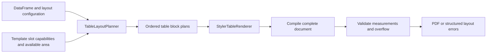

# Proposed table layout configuration

Status: design proposal, November 10, 2026. The configuration in this document is
not implemented yet. Today the engine supports `longtable: true` for row
pagination and template-authored landscape/sideways environments. It does not
automatically wrap, split, shrink, or choose orientation for wide tables.

## What to do when a table grows

| Table shape | Recommended display |
| --- | --- |
| Few rows and columns | Inline native table in the current document flow |
| Many rows | Multi-page table, repeated column headers, and continuation notes |
| Long text cells | Explicit paragraph column widths with wrapping |
| Many numeric columns | Landscape page, then explicit column groups if needed |
| Many rows and columns | Split columns into labeled groups; paginate each group vertically |
| One row taller than a page | Return a layout error; ask the caller to restructure or explicitly shorten that content |

Row count and column count alone do not determine fit. Physical width, rendered
text, font metrics, padding, available page space, and wrapped row heights matter.
Pagination should normally depend on available space rather than an arbitrary
fixed number of rows per page.

## Separate horizontal, vertical, and page policies

| Policy | Controls | Suggested first version |
| --- | --- | --- |
| Page placement | Inline block or dedicated page-level table | Explicit `inline` / `page` |
| Orientation | Current template orientation or dedicated portrait/landscape pages | Explicit `inherit` / `portrait` / `landscape`; no `auto` initially |
| Horizontal layout | Column widths, wrapping, splitting, alignment | Explicit widths and column groups |
| Vertical layout | Page breaks, repeated headers, group-label repetition | `single_page` / `paginate` |
| Typography | Font size and cell padding | Fixed values with a minimum allowed font size |
| Overflow | What happens when the chosen policy still cannot fit | Return a structured error, preserve diagnostics |

Do not silently drop rows/columns, truncate text, reorder data, or shrink text to
an unreadable size. These would change the meaning or usability of a report.

## Example: a wide, long customer table

Proposed JSON metadata fragment; YAML represents the same fields and Python can
construct the same model directly:

```json
{
  "inputs": {
    "customer_metrics": {
      "type": "table",
      "preset": "financial",
      "layout": {
        "placement": "page",
        "orientation": "landscape",
        "font_size_pt": 9,
        "min_font_size_pt": 8,
        "horizontal": {
          "mode": "split",
          "repeat_columns": ["customer_id", "customer_name"],
          "column_groups": [
            {"title": "First half", "columns": ["q1", "q2"]},
            {"title": "Second half", "columns": ["q3", "q4"]}
          ],
          "columns": {
            "customer_id": {"width": "22mm", "wrap": false, "align": "left"},
            "customer_name": {"width": "40mm", "wrap": true, "align": "left"}
          }
        },
        "vertical": {
          "mode": "paginate",
          "repeat_header": true,
          "repeat_group_labels": true,
          "continuation_note": true
        },
        "on_overflow": "error"
      }
    }
  }
}
```

The generated report contains two table sections:

```text
Customer metrics - First half
Customer ID | Customer name | Q1 | Q2
... all rows, across as many pages as needed ...

Customer metrics - Second half
Customer ID | Customer name | Q3 | Q4
... the same rows, across as many pages as needed ...
```

This is the initial reading order: finish the rows for one column group before
starting the next group. Coordinating matching row ranges across adjacent page
groups would be a separate, more complex policy.

The proposed Python layout layer would implement column splitting. Native LaTeX
pagination handles each group's rows. `longtable` alone does not split excessive
columns into multiple tables.

## Horizontal behavior

### Mode: wrap

Produce one table using explicit paragraph widths for text columns. Short numeric
columns remain aligned and compact. Wrapping increases row height, which may
increase the number of pages.

The initial implementation should support validated fixed widths and alignments.
Flexible remaining-space columns can be added through a dedicated backend after
package compatibility is tested. Candidate LaTeX tools are paragraph columns,
`tabularx` for flexible-width single-page tables, and `xltabular` for flexible-width
tables that also paginate.

Unbreakable identifiers and URLs need an explicit break policy or sufficient
width; ordinary paragraph wrapping does not guarantee they will fit.

### Mode: split

Render explicit column groups as separate table blocks, preserving source row
order. Repeat identifier columns in every block so readers can match a row across
sections. A split group may still use configured text wrapping.

Validation should require:

- All referenced columns exist and their selectors are unambiguous.
- Repeated columns and group columns do not overlap.
- Each non-repeated column appears exactly once unless explicit duplication is
  separately supported.
- No data column disappears because it was absent from the grouping rules.
- Group titles and continuation labels are escaped as plain text.

For duplicate labels or MultiIndex columns, define structured column selectors
rather than relying on flattened display labels. The simple JSON example assumes
unique string column names.

### Mode: preserve

Keep one table with natural column widths. Use this for known, bounded shapes.
If it exceeds the configured available area, return an error rather than silently
clipping it. A later explicit bounded-shrink mode may reduce font size/padding
only as far as the configured readability limits permit.

## Vertical behavior

### Mode: paginate

Use a breakable table environment with repeated column headers and an optional
continuation footer. Keep ordinary rows together. TeX determines page breaks from
actual rendered heights.

For MultiIndex row groups, prefer repeating group labels on each row rather than
emitting a merged cell that spans a page break. This is the purpose of
`repeat_group_labels`; it is distinct from repeating the column header.

A row that cannot fit on an otherwise empty page is an error in the initial
policy. Do not split a single logical record across pages automatically. If the
application wants truncation or an appendix for long narrative cells, it should
request that transformation explicitly before rendering.

### Mode: single_page

Keep the table on one page and fail if it does not fit. This is useful for small
summary tables whose surrounding layout depends on their staying together.

An optional `max_rows_per_block` could be added for business grouping, but it
should not be presented as a guarantee of physical fit. Ten wrapped rows may
consume more space than forty short rows.

## Preserve template ownership of the page

Metadata cannot change a page independently of its surrounding template. An
inline placeholder might be inside a minipage, centered block, float, or narrow
column. A multi-page table or a landscape transition cannot safely be inserted
into every such container.

Add template-declared slot capabilities as part of this feature. An example
capability set for a page-level slot is:

```json
{
  "slot_capabilities": {
    "customer_metrics": {
      "placement": "page",
      "allow_page_breaks": true,
      "allowed_orientations": ["portrait", "landscape"]
    }
  }
}
```

The template author declares what the slot permits; the table layout selects a
policy within those limits. Reject landscape pagination inside an inline-only
slot. Templates must load the required packages and provide compatible headers,
footers, and available-area information.

For page-level table blocks, include the title/caption in the block so they follow
the chosen orientation. Do not leave a heading on a portrait page while moving
only its table to a landscape page. Inline blocks should retain template-owned
surrounding headings and captions.

`sidewaystable` remains useful for a single-page rotated float. It is not the
mechanism for a multi-page table; use landscape pages with a breakable environment.

## Object-oriented implementation

The existing table renderer currently combines formatting and environment choice
in one method. Add planning objects and keep those concerns separate:

| Object | Responsibility |
| --- | --- |
| `TableLayoutConfig` | Pydantic model containing page, horizontal, vertical, typography, and overflow policies |
| `ColumnLayout` | Validated selector, width, alignment, and wrap policy for a column |
| `TableLayoutPlanner` | Validate column coverage and slot constraints, select explicit column groups and rendering environments |
| `TableRenderPlan` | Immutable ordered table blocks with selected columns, widths, orientation, title, and pagination policy |
| `StylerTableRenderer` | Apply formatting/highlighting and emit each planned table block without altering business values |
| `TableLayoutValidator` | Check actual compile measurements and table-specific overflow diagnostics |

Proposed package organization:

```text
metadata/
  table_layout.py       # Configuration models
layout/
  models.py             # TableRenderPlan, TableBlockPlan, available-area values
  planner.py            # TableLayoutPlanner
  validation.py         # Measurements and overflow result checks
rendering/
  tables.py             # Consume the plan and generate native LaTeX
```

The planner must not invent exact row page breaks before TeX renders wrapped
content. Its plan selects the environment and policies; the compiler performs
physical pagination.



## Measurement before automatic policies

Explicit widths, font sizes, and groups make a useful first version without
guessing. Robust `auto` behavior requires more than counting columns or estimating
string lengths in Python.

Templates need to expose actual printable area/slot dimensions. TeX can provide
dimensions for candidate table layouts. The renderer already adds table-boundary
markers and associates reported overfull boxes with generated inputs. Width above
`compiler.table_overflow_tolerance_pt` is an error. Automatic layout planning still
needs measurements of candidate layouts and the available area.

After measurement exists, a later bounded automatic policy could try:

1. Wrap configured text columns at the preferred font size.
2. Use landscape if the template slot permits a page transition.
3. Split approved column groups while repeating identifier columns.
4. Optionally reduce font size/padding within explicit minimums.
5. Return `table_too_wide` if no permitted candidate fits.

Make the retry count and selected policy visible in diagnostics. A successful
compiler exit alone is not evidence that a table fits; overfull content can still
produce a PDF.

Never wrap a paginated table in a whole-table `resizebox` or similar unbreakable
box as a fallback. Doing so removes the intended page-breaking behavior.

## Configuration precedence and compatibility

Proposed precedence is application defaults, template/table metadata defaults,
then supported per-render `TableInput` overrides. Overrides must remain within
the slot's allowed layout and readability limits. Log the resolved policy.

Keep existing examples working during migration:

- `longtable: true` maps to `layout.vertical.mode: paginate`.
- Existing metadata without `layout` retains its current behavior.
- Reject contradictory old/new settings instead of choosing silently.
- JSON, YAML, and Python model inputs use the same configuration objects.

## Suggested implementation sequence

1. Add the configuration models, validation, and explicit slot/placement contract.
2. Add fixed column widths, wrapping, alignment, and readable font/padding settings.
3. Extend pagination with header/continuation control and repeated group labels.
4. Support explicit landscape page blocks and explicit column groups.
5. Add table-specific measurements, overflow errors, and only then bounded auto-fit.

Validate with long text cells, unbreakable labels, tall rows, multi-level headers,
many columns, MultiIndex groups near page breaks, repeated identifiers, heatmaps,
and tables that are both wide and long. Check extracted data coverage and page
images, not only whether compilation succeeds.

## Relevant LaTeX building blocks

- [longtable](https://ctan.org/pkg/longtable): page-spanning tables with repeated
  headers/footers and consistent column widths.
- [tabularx](https://ctan.org/pkg/tabularx): paragraph-like flexible-width columns
  for a declared table width.
- [xltabular](https://ctan.org/pkg/xltabular): combines flexible columns with
  page-breaking table behavior; verify compatibility with Styler and texres before
  adopting it.

These tools provide rendering mechanisms. Configuration, data-preserving column
splitting, slot validation, and policy selection remain responsibilities of this
project.
